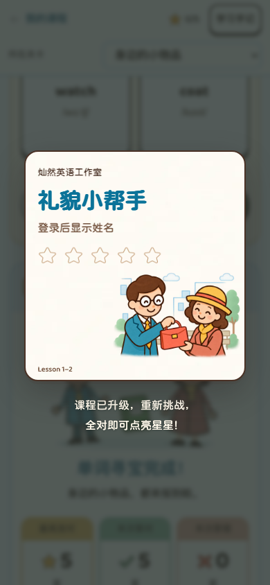

# 悬浮纪念卡正式接入与验收 v0.22

2026-10-10 16:46。工作树 `debug-reward-current`，分支 `codex/debug-reward-version`，基线 `74c280e`。本轮修改正式课程源码，尚未提交、推送或部署。用户已确认 [C 方案与精简文案](2026-10-10-1315-v0.21-获星弹窗与升级反馈演示方案.md)。

后续调整：用户明确要求奖励默认有动效，现行行为与补充验证见 [v0.23](2026-10-10-1719-v0.23-奖励结算默认动效与验收.md)。下文减少动态静态卡片为本轮历史验收，不再是奖励浮层的现行规则。

## 接入范围

Lesson 1–2、3–4、5–6 共十五个答题区。分别显示手提包、雨伞与新朋友的已确认卡面。其他课程尚未迁入五区纪念卡，不把原有奖励硬套成这套新卡。

| 真实结果 | 显示方式 |
| --- | --- |
| 当前奖励版本新获第 1–4 颗星 | 悬浮卡片，新增星落入空位，亮星有暖光与缓慢高光；普通边框。 |
| 当前版本新获第 5 颗星 | 同一卡片点亮第五颗星，出现流动金边，显示第一次满星的日期。 |
| 已提交的旧轮次升级后续做完成，当前版本不能发星 | 保留学习完成和已有当前版星数，卡下只显示“课程已升级，重新挑战，全对即可点亮星星！”。不落星、不伪造新金边或日期。 |
| 错答订正、已有星重练、等待服务器确认 | 原完成页短反馈，不用获星浮层假装发奖，也不误报升级。 |

卡片外没有标题、按钮、关闭图标或“点击退出”等说明。点击卡片、升级提醒或背景即退出；Esc、回车、空格等效。可以在落星过程中立即关闭，返回可操作的完成页。移动端提醒按语义换成两行，320px 窄屏和390×500短屏也能完整呈现。

## 成果与展示分开

- 继续使用现有五区零错判定；没有更改题目、奖励版本或学生成果结构。全部题目的第一次提交正确才获本轮星，提示不算错答，订正不补发本轮星。
- 登录学生以现有服务器获星记录为准。本地待同步时不提前点星；同步实际确认后显示一次。同一服务器结果重复回传、刷新和另一设备查看旧成果不重播。
- 成果先保存，动画只呈现结果。提前退出、减少动态偏好和动画异常不影响星星或日期。首次五星日期仍由原奖励记录决定。
- 姓名直接来自登录账号。匿名内部课件预览显示“登录后显示姓名”，班级预览显示“班级预览”，都不冒充学生，也没有姓名输入。
- 升级浮层只在用户主动完成续做这一轮时出现；回看旧完成页仅保留短提醒，不逐个自动弹出。只打开旧页面的空白草稿仍可首轮获星。
- 切换账号、页面离开、身份核验锁定时关闭浮层并清理动画；关闭动作不触发下面的按钮。

## 实现与加载

`core/award-reveal.js` / `.css` 是三门课程共同使用的展示组件。`core/unit-awards.js` 仅在确实新增已确认星时通知组件；练习引擎给结算标记是否源自本次主动完成，区分恢复页面与新完成。纪念卡页和浮层共用 `core/story-certificate.js` 的卡面渲染，避免姓名、日期或插画各自实现而漂移。

素材复用原有三张纪念卡、纸纹和星星，没有新增视频或配音。脚本、样式和引用图片纳入原课程资源包，缓存版本自动随文件内容更新。原始内部预览也等图片解码与字体就绪后才打开浮层。

动画由浏览器完成，没有逐帧服务器请求。现有成果同步接口承担发星，本轮没有新增接口或数据库写入路径。落星光尘数量有界，退出即清理；这不等于服务器并发压测或安卓微信真机已经验收。

## 页面验收

所有成果由临时学生或匿名测试页真实点击产生；升级使用冻结的历史课件先作答再切回新版，没有直接注入星星或改数据库。

- 新增检查：三单元各五个真实答题区点星，第五星才出金边与固定日期；第一颗星、两种键盘退出、点卡片／背景／提醒退出；动画途中退出清理、减少动态静态结果；三课历史途中升级、重练与刷新不重播；错答后订正和已有星重练。
- 账号检查：离线不预发星、联网后一次结算、长姓名、另一设备不重播、不同学生隔离、服务器五星日期、卡面与纪念册一致、退出账号立即关闭浮层。分别检查根目录与 `/lesson/`。
- 回归检查：原有三单元升级、空白旧草稿、Lesson 1–2 完成页和五区零错规则，真实三卡纪念册与 PNG 导出，缓存后断网完成课程。
- 原有纪念册脚本在新奖励弹出后仍点击背景课文，曾被新浮层拦住；已补入真实关闭步骤并等待服务器成果同步，未跳过收藏、导出或账号隔离断言。
- 首轮金边检查发现共享样式的选择器未命中；已修正并验证边框实际亮起、角度持续变化，不只看静态代码。

实际运行通过 **45 项页面检查**（按下面命令范围计数，根目录与子路径账号用例分别计入）：

| 检查组 | 最终结果 |
| --- | --- |
| 新悬浮结算、三课奖励、两类旧版迁移、Lesson 1–2 完成页和原奖励 | 26 通过 |
| `/lesson/` 临时账号悬浮结算 | 3 通过 |
| 根目录账号悬浮结算、纪念册、原有账号奖励 | 8 通过；其中三课纪念册用例在补齐关闭操作后重跑通过 |
| Lesson 1–2 缓存后断网全课与证书 | 1 通过 |
| 同一练习引擎的 Lesson 25–26、升级／重试、问句草稿与交包时机 | 7 通过 |

本地内置浏览器另外实际答完 Lesson 1–2 单词寻宝，确认悬浮首星画面。正式账号构建校验通过，覆盖21个受保护单元；新增组件会随课程缓存版本发布。语法检查和差异空白检查通过。

未执行正式发布全量验收；安卓／iPhone 微信真机、儿童试用与线上验证待验收。代码未提交、未推送、未部署。

## 画面证据

以下为正式课程截图，登录样例使用临时测试学生“小雨”，不是修改真实学生资料。

[本地真实首星](evidence/2026-10-10-1646-reward-integration/course-first-star.jpg) · [320px升级提醒](evidence/2026-10-10-1646-reward-integration/unit1-2-upgrade-320-640.png) · [390×500短屏](evidence/2026-10-10-1646-reward-integration/unit1-2-upgrade-390-500.png) · [三课满星：1–2](evidence/2026-10-10-1646-reward-integration/unit1-2-full.png)、[3–4](evidence/2026-10-10-1646-reward-integration/unit3-4-full.png)、[5–6](evidence/2026-10-10-1646-reward-integration/unit5-6-full.png)。
