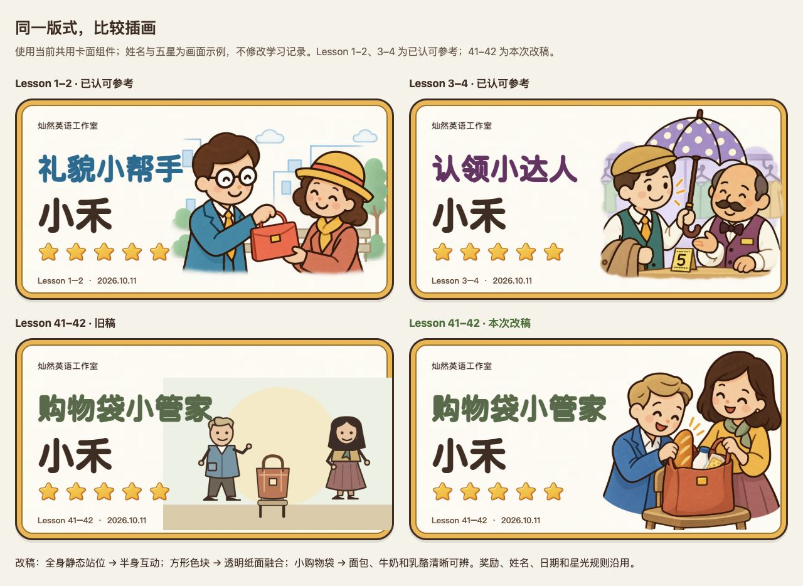

# Lesson 41–42 纪念卡优化

2026-10-11 20:48 · `codex/debug-grammar-v2` · 本地改稿，待用户审美确认。课程与教学验收见 [v1.0](2026-10-11-1753-v1.0-Lesson41-42设计与验收.md)。

用户仍认为与前两课有差距，当前继续优化为 [v1.2：构图与质感](2026-10-11-2114-v1.2-Lesson41-42纪念卡构图与质感优化.md)。本篇图片及检查保留为上一稿记录，不代表已获认可。

## 原因与修正

旧卡直接拼入舞台的全身人物、椅子和购物袋，人物静止、物品太小，矩形底色截断纸面。上一轮检查了可见性、奖励和导出，却没有与已认可的 Lesson 1–2、3–4 在同尺寸下比较插画，功能通过掩盖了美术质量差距。

本次用内置 imagegen 参照两张已认可插画重绘：Sam 从袋里拿起面包，Penny 扶住提手；采用半身近景、表情互动、棕色描边和纸面质感。购物袋、牛奶与乳酪清晰可见，透明边缘自然融入卡面。人物沿用本课身份与服装，不引入其他课的人物。

课程底部、获星浮层、账号纪念册与 GIF 均使用 `assets/unit41-42/keepsake-closeup.webp`。共用卡面、称号、奖励版本、五区标识、星数、首次满星日期和交互规则不变；这次换图不要求重做课程。原稿保留作对照。

## 实际验证

- 隔离账号页面流程通过：43题、五次获星动画、结算衔接、五星同步、纪念册点击放大、跨浏览器姓名和日期恢复、GIF下载，以及原有离线恢复检查。命令：`LOGIN_TEST_PORT=4302 AWARD_TEST_BASE=/ npx playwright test -c playwright.login.config.js tests/login/unit41-42.spec.js -g '真实账号全流程'`，1项完整流程通过。
- 目视核对桌面卡、纪念册放大、320／390宽度手机卡、实际导出GIF；未见文字或星星遮挡人物。GIF为984×528、60帧循环，另查看首帧确认使用新插画。
- 4296完整账号预览从首页重新进入后显示新图；现有体验账号的语法结算仍为9／12／2，0星，未改动学习记录。
- 生成PNG保存在证据目录；运行时WebP为1000×1000、有透明通道、约137 KiB。[素材来源与哈希](evidence/2026-10-11-2048-unit41-42-card/manifest.json)、[完整提示词](evidence/2026-10-11-2048-unit41-42-card/keepsake.prompt.txt)、[截图与动图](evidence/2026-10-11-2048-unit41-42-card/index.html)。

后续纪念卡先与已认可卡面同尺寸对照，检查人物、动作、道具、纸面融合与缩小后的辨识度，再检查手机和导出。不能直接把舞台缩略图当作纪念卡，也不能把功能检查当作美术验收。

本次未提交、未推送、未发布；未进行真实手机微信或儿童试用。图片风格是否满意仍待用户确认。
