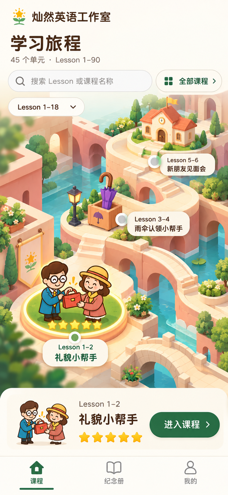

# 旅程地图方案与生成规范 v1.0

> 历史方案、实现与验证记录。现行首页入口规则统一见[统一设计标准 v2.0](2026-10-22-1332-v2.0-首页入口统一设计标准与验收清单.md)；本文件保留当时取舍和证据，不作为另一套现行规范。认可视觉和冻结素材仍作为来源。

2026-10-20 00:16（北京时间）· 分支：`codex/fronted-opt-version`。

历史方案提示：本页保留初始视觉与生成依据，45 单元等示例和“未实施”仅代表当时状态。后续交互、响应式和回归要求以[现行补充规范 v1.2](2026-10-21-1908-v1.2-旅程首页与纪念册问题修复及设计约束.md)为准，当前功能与测试见[v1.1 实现记录](2026-10-21-0207-v1.1-旅程地图首页实现与验收.md)。认可图、提示词及哈希锁定文件保持原样。

## 1. 已确认的方向

用户已明确选择上一轮第三张「旅程地图」，并认可人物和环境。视觉唯一主基准为 [approved-mobile-v1.png](references/approved-mobile-v1.png)，保留原始 853×1844 像素，不覆盖、不重新压缩。SHA-256：`2497505dda0afae854e47d2bee003f70e96fb8650979c168369905a30fd17b7f`。



本轮细化课程首页、目录、搜索、响应式布局和素材生成方法。人物与环境的既定画风保持；下面的交互和制作参数是本轮具体化方案，不表示功能已经开发或上线。桌面和搜索补充图是同一方案的扩展稿，不能自动取代用户已认可的手机基准。

课程内教学、五区五星、纪念卡、账号隔离仍以[统一设计标准 v1.49](../../butcher-version/publish/2026-10-14-0013-v1.49-教学单元设计标准与验收清单.md)为准。本方案只改变首页展示和查找方式。早期「十二城区、Lesson 1–144」草案不作为当前课程分组依据。

## 2. 首页的组织方式

**一个课程入口、两种找课方式：地图探索与完整目录。** 同一课程使用同一个 ID、名称、进度和进入地址。

- 首页标题「学习旅程」，保留星花品牌。课程数取当前账号真实授权数量；45 个单元、Lesson 1–90 是本地演示范围。
- 搜索始终可见，支持课号和课程名称；「全部课程」始终有明确入口。
- 章区只收拢地图范围，不拆成多个课程库，也不增加权限或解锁条件。
- 示例按五个区间组织：Lesson 1–18、19–36、37–54、55–72、73–90；每区 9 个配对单元。
- 一段场景承载 3 个单元。首段为 Lesson 1–2、3–4、5–6，对应交还手提包的圆形广场、紫色雨伞寄存亭、欢迎学堂。
- 手机首屏聚焦当前节点及相邻节点，纵向自然浏览当前章区。目录、搜索跨全部授权课程，不要求从第一个节点走到末尾。
- 45 个单元对应 15 个美术场景段只是制作规划，本轮没有声称已完成其余 14 段。

[课程快照](catalog-snapshot.json)从当前各单元的真实 HTML 标题读取，共 45 条。它用于设计校对；运行时授权、课程开关、续学路由和星数仍由现有服务提供，不能读取这份快照作为权限来源。

## 3. 核心交互

| 操作 | 页面行为 | 保留的状态与边界 |
| --- | --- | --- |
| 首次进入 | 选中上次有效课程；没有记录则选择第一门已授权课程。 | 场景未完成加载也可使用目录，避免等待装饰素材才能学习。 |
| 点击地图节点 | 更新选中描边、课程名称、星数和下方操作区。 | 点击只选中，不直接进入课程，不触发发奖，不强制移动已经可见的节点。 |
| 点击「进入课程／继续学习」 | 使用现有课程入口与真实续学地址。 | 沿用权限校验和学习记录，不新建一份成绩。 |
| 搜索 50 或 Lesson 50 | 精确匹配 Lesson 49–50，显示「晚餐采购大冒险」。 | 不能把 5、15、51 等作为数字 50 的匹配。名称可模糊匹配。 |
| 点击搜索结果的「进入课程」 | 直接进入目标课程。 | 不必先加载目标地图。 |
| 点击「地图定位」 | 切换对应章区／场景段，定位并选中目标节点。 | 只有这种明确定位操作才移动视口；系统减少动态时直接定位。 |
| 搜索结果唯一时按回车 | 选中结果，聚焦其主操作。 | 不因输入结束自动离开首页。 |
| 打开全部课程 | 手机打开目录层，桌面在左侧目录区展开完整列表。 | 默认全部；支持区间筛选，仍然使用全局课号搜索。 |
| 关闭目录／清除搜索 | 返回原地图位置与已选课程。 | 恢复触发按钮焦点，关闭动作不点击穿透。 |
| 返回首页或刷新 | 恢复有效章区、节点与视口位置。 | 存储按学生隔离；失效授权只调整当前显示，不删除历史成绩或纪念卡。 |
| 切换「纪念册」「我的」 | 使用现有入口和账号区域。 | 修改密码、退出登录仍收在「我的」内。 |

节点必须同时显示 Lesson 范围和课程名称，禁止再次出现仅有数字的目录。图形节点和列表项均有至少 44px 的实际可点击范围，并提供可读的辅助技术名称。

## 4. 选中、授权与成果分开表达

| 状态 | 表现 |
| --- | --- |
| 已授权、未选中 | 暖白节点＋绿描边，名称清楚；中性标记不代表锁定或未完成。 |
| 当前选中 | 深绿标记、轻微局部高亮；底部／侧边操作区同步更新。 |
| 0 星至 4 星 | 根据服务端真实成果显示对应星位；选中和访问都不会加星。 |
| 5 星 | 显示已获五星标记；地图不重复播放课程中的发奖和领取动画。 |
| 尚无授权 | 不把未开放课程塞进当前学生的可进入目录；直链仍交给服务端校验。 |
| 教师预览／演示数据 | 明确遵循现有预览身份规则，不把演示成果当作学生真实奖励。 |

地图与课程操作区显示的是同一份星数快照，两处五星不表示获得十颗星。纸面模型中的五颗星只是演示状态，不能绘入生产环境底图或人物图中。

## 5. 手机、平板、桌面布局

| 视口 | 布局 |
| --- | --- |
| 320×568 短屏 | 紧凑品牌和搜索；地图纵向自然滚动；当前课程操作区和底部导航留出安全边距。允许只看到当前及一个邻近站点，不缩小文字来挤完整地图。 |
| 390×844 手机基准 | 延续认可稿的场景比例、人物和建筑。上方品牌／搜索／章区，下方约 104px 当前课程区＋至少 56px 导航，适配设备安全区。 |
| 平板至 1023px | 继续单列地图，可展示更宽的场景；目录层宽度受控，不能把手机图片横向拉长。 |
| 1024px 及以上 | 顶部共用导航；约 340px 左侧目录与当前课程区；右侧宽幅地图。基准目标 1440×1024。 |

文字沿用统一设计标准：中文寒蝉圆黑体、英文 Nunito；正文约 16px、辅助文字不小于 14px，标题约 28px。示意图的手工字体效果不构成引入另一套生产字体的要求。

手机目录层按结果内容占可用高度约五成半至七成半，可随内容向上展开；屏幕阅读器可识别为模态区域。搜索补充图为查询完成、键盘已收起的状态。软键盘出现时优先显示输入、结果和操作，地图可以退居背景；使用动态视口高度及安全区，不能把确认按钮压在键盘后。

场景底部必须预留当前课程区和导航的占位，首尾节点能滚到完全可见处。滑动、点节点、关闭目录不会引起整页突然跳位。悬停反馈同时具有触摸和键盘对应状态。

## 6. 动效的分寸与加载

- 无强制开场动画，页面准备好即可使用。人物和环境的吸引力来自画面本身。
- 节点选中约 180ms；目录展开约 220ms；用户明确触发的地图定位约 280ms。这些是实现目标，需真实页面复查后调整。
- 可选视差位移不超过 3px，只用于当前场景，并默认关闭常驻环境动效；不要通过设备倾斜权限或持续晃动制造效果。
- 点击人物不是另外一套隐蔽入口，主入口仍是具名的课程节点和「进入课程」按钮。
- 系统减少动态时去掉地图视差、镜头移动及装饰过渡。现有纪念卡奖励光效规则单独沿用，不在本轮重写。
- 当前场景优先加载，邻近段按需准备；不一次解码 45 个大场景／人物图。
- 图片失败时保留真实课程标题、状态和目录入口，提供「重新加载地图」。地图图片失败不能把账号切换为匿名或清空成绩。
- 内部验收目标：中端手机普通节点切换可及时响应，无持续主线程动画；具体帧率和资源预算需资产落地后实测，当前没有性能通过结论。

## 7. 固定人物和环境

### 人物

认可稿的地图人物是暖棕描边的二维故事插画，放在有体积的建筑环境中。全身约 2.2–2.6 头身只是辅助描述，具体以认可稿为准。

| 人物／道具 | 固定辨识信息 |
| --- | --- |
| Lesson 1–2 男士 | 棕色侧分头发、深色大圆眼镜、蓝绿色外套、暖白衬衫、黄色领带、棕色鞋。 |
| Lesson 1–2 女士 | 棕色及肩卷发、赭黄色帽子和珊瑚色帽带、陶土／珊瑚色外套、黄色围巾、棕色鞋。 |
| 手提包 | 两人互动中的单个红色手提包和简洁金色扣件；手、视线与交接关系清楚。 |
| 其他课程 | 从该课已确认人物与关键道具取身份，统一成这套地图比例。不能把同一对男女复制到所有课程。 |

脸型、衣服、配饰、道具、头身比和轮廓粗细固定。已有合适角色素材优先直接复用；确需补动作时，以该课角色原图和本认可稿共同作参考。新人物身份尚未确认时，不凭课程名自动编造。

### 环境

固定为暖日光下的连通微缩建筑：奶油石路、浅珊瑚／桃色墙体与拱桥、陶土屋顶、青绿色水面、玉绿／橄榄绿植物、少量暖黄色细节。镜头维持认可稿的俯视三分之四视角和近似平行竖线；光从左上方来，阴影柔和地落向右下方。

保留哑光材质、柔和体积、清楚路径和足够留白；不改成浮空岛、太空轨道、摄影写实、塑料黏土、深夜霓虹或另一种游戏世界。已有水面、路面、拱桥、植物可作为跨场景的可复用素材，不需要每次重新生成。

[色彩与布局参数](tokens.json)是落地时的工作色和尺寸目标；三维光照下存在自然明暗变化，不能用单个十六进制色值替代整张认可图。

## 8. 生产素材分层

| 层 | 内容 | 是否随状态重新生成 |
| --- | --- | --- |
| 环境底图 | 水面、地形、石路、拱桥等静态基础。 | 否。 |
| 地标 | 雨伞亭、学堂等课程相关物件；需要时独立输出。 | 否，只有新课程／情境才新增。 |
| 人物 | 透明背景、完整身体与道具，至少 10% 安全留白。 | 尽量复用，补动作时单独生成。 |
| 少量前景 | 树枝、花、近景遮挡，不能遮住人物和可点击区域。 | 否。 |
| 选择与星数 | DOM／代码绘制的选中状态、实际星数。 | 不进入生成底图。 |
| 文字和操作 | 品牌、课号、姓名、标题、搜索、目录、按钮、导航。 | 实际页面用组件与真实数据。 |

因此，UI 效果图仅用于对照构图；不能把一张带文字和五星的整图铺成网页，再在上面放透明按钮。

## 9. 提示词与参考图的固化方法

本包保留了用户认可原图、历史生成提示词及五种后续生成配方。生成流程不是只复制一段描述：

1. 首张输入图始终为 `approved-mobile-v1.png`；其余输入按配方确定身份、道具或品牌用途。
2. 先校验文件哈希，再按「固定风格 → 本次输入图顺序 → 场景／状态模板 → 固定排除项」组合提示词。
3. 只有配方中显式声明的画布、页面状态、课程、地标和动作可变；不让光照、画风或镜头随每次文案漂移。
4. 每次保留输入顺序、完整提示词、提示词哈希、工具、输出文件哈希、人工检查结论。
5. 候选生成图不自动晋升为新基准。原认可图持续保留；用户明确认可新基准后，再建立新版本。
6. 通常保持同一生成工具；内置工具未提供可固定的随机种子或后端模型版本，本包如实记为 null，不伪造可重复参数。

### 已保存的提示词

| 文件 | 用途 |
| --- | --- |
| [历史完整提示词](provenance/original-request.txt) | 从原会话中记录的固定模板、角色说明替换和方向段确定性重建。它用于追溯，不是今后重新探索其他风格的入口。 |
| [固定风格母版](prompts/style-lock.txt) | 人物、衣着、道具、环境、镜头、光照、材质与 UI 的不可变部分。 |
| [固定排除项](prompts/negative.txt) | 画风漂移、错误人物、烘焙进度、裁切与多余功能的排除要求。 |
| [手机首页](prompts/mobile-home.txt) | 手机布局适配，保持原人物和环境。 |
| [桌面首页](prompts/desktop-home.txt) | 同一世界的宽屏扩展。 |
| [目录／搜索](prompts/mobile-directory.txt) | 全局目录和 Lesson 50 定位状态。 |
| [环境底图](prompts/environment.txt) | 不含人物、UI、文字或星数的可复用场景。 |
| [人物素材](prompts/character.txt) | 按批准身份和动作生成透明背景角色。 |

### 调用方式

在仓库根目录执行：

```powershell
node docs/designs/course-journey/build-prompt.cjs --verify
node docs/designs/course-journey/build-prompt.cjs desktop-home
node docs/designs/course-journey/build-prompt.cjs mobile-directory
```

输出位于 `output/fronted-opt/journey-prompts/`，包含完整提示词、可传给内置 imagegen 的请求 JSON，以及参考顺序和哈希回执。脚本只组合与验证，不调用收费 API、不需要 API Key，也不会自动生成图片。

可用配方还有 `mobile-home`、`environment-opening`、`character-unit1-2`。透明人物配方明确传 `transparent_background: true`；界面稿和环境底图传 false。每次最多五张输入图，本包配方实际使用一至三张。

**可控制的是输入与风格约束，不是随机生成的逐像素结果。** 一致性靠原素材复用、固定参考、固定文案、分层制作和输出审核共同实现；不能宣称仅凭同一提示词即可保证两次图片完全一样。

## 10. 每次生成后的验收

以下任一关键项不合格，候选图就不能用作下一轮的主参考：

- 男士眼镜、发型、外套、领带及女士帽子、衣服、围巾没有漂移；其他课程采用自己的正确角色。
- 人物仍为暖棕描边的二维画法；头身比与当前认可稿相近，没有悄悄变成三维黏土。
- 相同情境中的道具身份、数量、交接、视线正确；头发、帽子、手和脚完整。
- 建筑配色、材料、光照方向、镜头和地形连通性一致；未出现新的世界主题。
- 标题与课号使用真实课程文案；输入 Lesson 50 的画面必须对应 Lesson 49–50。
- 搜索、目录、主按钮和节点名称可读，无下方操作区遮挡、无依赖裸数字的定位。
- 生产底图／人物图没有烘焙真实用户姓名、星数、日期或按钮；透明图有真实 alpha。
- 同一视口下把认可图与候选图一起查看，记录差异；必要时只修一项，不用整轮新风格重画。
- 图片验收不等于交互、授权、软键盘或真机性能验收。

## 11. 落地顺序与当前状态

先完成首段三个节点、全局真实课程目录、精确 Lesson 搜索和现有续学入口；随后按三节点一段扩展其余场景。其余课程始终可从目录进入，不能为了等美术而隐藏已授权的课程。

本轮交付：固定认可稿、历史提示词追溯、设计细化、工作参数、45 单元文案快照、五种可复用配方和生成前校验脚本，并用[桌面／搜索补充稿](generated/README.md)检查风格延续。完整提示词、输出尺寸、哈希和检查范围一同归档。

本轮未替换首页代码，未改变学习或纪念册数据。浏览器交互、iOS／Android 真机、软键盘、性能与无障碍验收均属于后续实现阶段。未提交、未推送、未发布。
