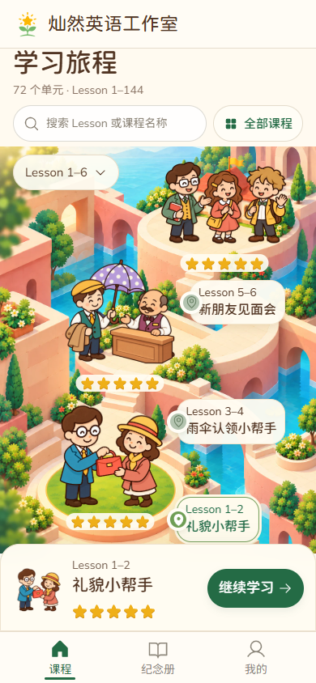

# 前三单元人物场景实现与提示词固化 v1.3

> 历史方案、实现与验证记录。现行首页入口规则统一见[统一设计标准 v2.0](2026-10-22-1332-v2.0-首页入口统一设计标准与验收清单.md)；本文件保留当时取舍和证据，不作为另一套现行规范。认可视觉和冻结素材仍作为来源。

2026-10-21 · `codex/fronted-opt-version`。

Lesson 3–4、5–6 已补齐与 Lesson 1–2 同一画风的人物和故事场景。前三个入口都包含关键人物、代表性道具或动作、所处场景、课名与真实星数。完整 72 单元目录和 Lesson 搜索继续按班级授权工作；本轮未扩展其余单元的地图。

## 每个单元入口的设计规则

每站呈现本课最易辨认的一段故事。纪念卡提供角色身份、服饰、道具和情节依据，地图使用适合落地站立的构图；地图人物和纪念卡保持联系，纪念册的原卡面和收藏记录继续保留。

- Lesson 1–2 保留原男女主角交还红色手提包及草坪圆台。
- Lesson 3–4 增加戴帽子的顾客、小胡子工作人员和木质柜台，围绕单把紫色圆点伞互动。环境中原有巨型伞与木箱移除，避免一课出现两套同义道具。
- Lesson 5–6 增加布莱克先生、苏菲和汉斯，分别保留眼镜与红书、黄发夹与黄肩包、金发与绿领结。三人在学堂前庭互相介绍；人物、脚和手完整。
- 每课使用自己的已确认人物，统一暖棕描边、温暖肤色、短肢体和简单阴影；不把 Lesson 1–2 的男女主角换装后复制到所有课程。
- 人物、局部道具、环境和运行时文字分层。课名、星数、日期与按钮不烘焙进图片。场景与人物统一按画布坐标缩放，文字保留可读尺寸。
- 地图、前三课快捷入口、当前课程区及搜索结果复用同一套人物图，帮助学生在不同入口认出同一课程。星数继续来自课程接口；选择或加载图片不会发星。

这些规则补充[现行界面约束 v1.2](2026-10-21-1908-v1.2-旅程首页与纪念册问题修复及设计约束.md)中的 J05、J09–J13；具体身份、生成输入与验收要求固定在[人物场景规则](production/story-nodes-v1/rules.md)。

## 素材与布局

| 素材 | 原生尺寸 | 网页编码大小 | 来源与验收 |
| --- | --- | --- | --- |
| [雨伞人物与柜台](../../../assets/course-journey/umbrella-counter-v1.png) | 1402×1122 | 167456 字节 | [两次请求及透明边界](production/story-nodes-v1/unit3-4-receipt.json) |
| [见面三人组](../../../assets/course-journey/friends-trio-v1.png) | 1536×1024 | 175874 字节 | [两次请求及透明边界](production/story-nodes-v1/unit5-6-receipt.json) |
| [手机环境 v2](../../../assets/course-journey/opening-mobile-v2.png) | 1024×1536 | 274858 字节 | [原始扩展、纵向修正和落点](production/story-nodes-v1/mobile-environment-receipt.json) |
| [桌面环境 v2](../../../assets/course-journey/opening-desktop-v2.png) | 1374×1145 | 302986 字节 | [平台及前庭调整](production/story-nodes-v1/desktop-environment-receipt.json) |

素材使用内置 `image_gen.imagegen` 生成。原生 PNG 保留，WebP 只做网页编码；没有程序绘制人物、抠图、阈值去背景或拉伸原图。原 v1 背景和手提包人物没有覆盖，纪念卡原图也没有替换。

手机环境改为 2:3 构图，为三组完整人物留出纵向空间；首课标签放在人物右侧，390×844 首屏的三个入口均可辨认和操作。320×568 保留自然滚动，不把人物与按钮缩成小点。桌面保留较宽地图和左侧课程区；平板、窗口旋转与同宽变高继续按可用空间选图和缩放。

落点以生成后的实际地面和可见轮廓标定，不能把提示词中的期望坐标直接写入布局。角色锚点、标签和星数统一维护于[场景配置](../../../course-journey/scene-layout.js)，本轮冻结快照见[位置记录](production/story-nodes-v1/placement.json)。手机中部人物向左调整，为学堂课名保留空间；见面人物组稍向左收拢，长屏放大时仍保留汉斯的挥手。

三课星数增加浅纸色衬底，避免金色星星与花草混在一起。人物图只承载故事，课程节点与“进入／继续学习”仍为明确的实际操作。

当前手机首段环境加三组人物共 764710 字节，桌面为 792838 字节，不含脚本、共用字体和其他课程插图。已有同源缓存可复用同一人物资源；上述大小不代表已通过真机弱网性能验收。

## 提示词固定与后续扩展

[固定包入口](production/story-nodes-v1/README.md)包含 7 份实际请求：两组人物初稿、两次人物局部修正、手机环境初稿与修正，以及桌面环境编辑。全部引用顺序、实际输出、原生尺寸和哈希保留；三个修正所依赖的候选图已复制进仓库。

[清单](production/story-nodes-v1/manifest.json)锁定 33 个文件，包括规则、请求、参考图、候选图、最终资产、编码记录和位置快照。重建脚本只输出请求，不自动调用图像服务：

```powershell
node docs/designs/course-journey/production/story-nodes-v1/replay-prompt.cjs --verify
node docs/designs/course-journey/production/story-nodes-v1/replay-prompt.cjs unit3-4
node docs/designs/course-journey/production/story-nodes-v1/replay-prompt.cjs unit5-6
```

重建时将历史绝对路径换成当前工作树中同哈希的文件，提示词原文、参考顺序与透明开关保持不变。原 v1.0 的 9 张参考、19 个固定文件及五种配方仍通过校验。相同提示词不能保证随机生成逐像素一致；后续优先复用已验收人物，再为新课程建立有自身角色依据的新配方。

## 实际验证与修正

- Chromium 根路径 7 个不同场景通过，覆盖稀疏授权、72 单元搜索、真实课程学习与跨设备成果、环境缺图恢复、手机操作、响应式及新人物边界。WebKit `/lesson/` 对搜索、缺图、手机、响应式及人物的 5 个场景通过；复跑不重复计数。
- 新人物检查采用已验收 PNG 的可见 alpha 边界，验证 320×568、390×844、390×1024、768×1024、1440×1024 下人物完整、比例正确且标签不遮人物。响应式检查另含 390×932、1024×768 旋转；三个节点、焦点和短屏访问继续检查。
- 真实阻断雨伞人物请求，另外两组仍显示，目录可以搜索；解除阻断并重试后恢复，星数及首次日期逐项不变。故障用例禁用 Service Worker，避免已有缓存绕过所需的失败请求，并要求实际拦截次数大于零。
- 19 项目录、字体包和检查选择逻辑通过；构建校验 72 个教学单元。两版提示词包、文档链接和格式分别核对。

首次发现 320px 宽度下首课标签超出地图约 3px，已调整标签位置及布局下限，原边界断言保留。首轮手机中首课标签位于固定底栏之后，最终将它移到人物右侧；背景星星辨识度不足则增加浅色衬底。最终手机与桌面实图均已和相同尺寸的原认可风格对照，见[视觉验收](../../../design-qa.md)。



实体 iOS／Android、微信、真实软键盘和全课弱网仍待验收。本次是开发与专项验证，未执行完整发布验收；未提交、未推送、未发布。
