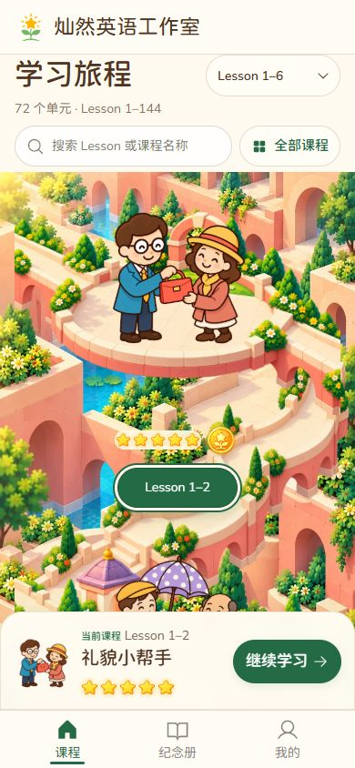

# Lesson 1–12 连续旅程恢复

日期：2026-10-24。范围：Lesson 1–12，共六个课程入口。分支：`codex/fronted-opt-version`。本文记录环境纠偏、保留的防串位结构及本轮验证；不代表正式发布。现行规则见[统一标准 J30／J31](2026-10-22-1332-v2.0-首页入口统一设计标准与验收清单.md#continuity)。

## 1. 问题与确认的调整方向

上一轮为解决人物与大图平台的串位，把每课改为独立的局部场景，但同时将整体环境改成大面积海水和彼此分离的小岛。这超出了布局适配所需的改变，也削弱了用户已认可的道路、建筑与植被相互连接的旅程感。

用户本轮明确要求：恢复先前认可的环境风格与连续旅程感，保留人物与地面同步缩放、防串位布局，先完成 Lesson 1–12，手机优先并提供本地预览。因此本轮改变环境构图，不退回依赖整张大背景绝对定位人物的方式。

原[独立场景样板记录](2026-10-23-Lesson1-12独立场景样板.md)保留当时真实问题、检查和取舍；海水氛围与孤立平台的视觉取舍由本文纠正，其历史通过数字不并入本轮验收。

## 2. 恢复连续环境，保留局部接地

| 层 | 本轮职责 | 不能承担的职责 |
| --- | --- | --- |
| 连续花园底图 | 恢复奶油石路、珊瑚砌体、拱洞、庭院与绿植相连的原环境语言；手机和宽屏使用适合自身比例的构图 | 不作为人物必须精确踩中的地面，不驱动课程状态 |
| 开敞庭院 | 复用原主题建筑和中央铺地，打开左右入口与出口；人物仍使用原素材 | 不生成新人物，不把界面文字或星章烧入图中 |
| 段间连接桥 | 按相邻局部 stage 实际矩形和连接端口计算，用作道路与空间的装饰过渡 | 不移动人物脚底，不替代本课地面，不成为课程点击区域 |
| 单课人物与地面 | 共用固定 3:2 局部 stage、父坐标及 motion；响应式和短促点击反馈一起运动 | 不因中文名、星数、选中或窗口高度分别改变位置 |
| 星章与 Lesson 编号 | 普通文档流，固定跟随所属场景下方；金章与本课星星同排 | 不为桥路让位而漂到邻课，不回到侧排绝对坐标 |
| 导航、目录和学习区 | 保留 72 单元的授权、Lesson 搜索、目录与续学能力 | 不因试点仅六个入口缩小课程集合 |

连续不是“颜色相同”或“放一条线在两张图之间”。实际页面要看道路从哪里进入庭院、从哪里离开、相邻连接是否合理，人物是否真实站在铺地上，以及整个手机滚动过程中能否感到仍在同一座花园中旅行。

## 3. 手机与宽屏的布局约束

1. 手机继续纵向自然滚动，按 Lesson 顺序浏览完整单课场景。空间不足时增加滚动长度，不按屏幕高度压缩人物，不把字号与触控目标一起缩小。
2. 庭院与人物内部坐标固定，整组缩放；背景可选择适合宽高比的构图与裁切，但不改变本课真实接地点。
3. 段间桥路从当前渲染后的 stage 矩形计算。布局宽度、模块排列或窗口尺寸变化后重算；不把某一手机截图中的页面绝对坐标复制到所有设备。
4. 石桥位于课程模块后方，无点击事件，不改变普通文档流，不挤压星章／课号或拦截点击。石桥接缝与装饰裁切不能成为隐藏人物或成果的理由。
5. 保留完整场景下 6px 星章行、再下 8px Lesson 底牌的归属关系，尺寸基线仍见 J30。选中前后、零星／部分星／满星之间不改变局部接地。
6. 底部学习卡使用真实高度补偿。长中文名、导航高度或软键盘不能反过来改变人物和地面坐标。
7. 宽屏允许调整整课模块排列和外围环境密度；手机优先，不要求同一底图在所有比例中机械拉伸。两种构图仍须属于同一已认可环境。
8. 原人物与地面失败按本课降级及重试；底图和连接桥失败只撤去装饰，不阻塞可用课程。首次满星仍需等本课人物／地面真正就绪后再消费庆祝状态。

## 4. 美术与提示词追溯

本轮采用 modules-v2 版本包，不覆盖 modules-v1 的冻结原稿。六个开敞庭院保留各课主题：

| Lesson | 主题与保留的人物 |
| --- | --- |
| 1–2 | 小花园归还手包；原 handbag-couple |
| 3–4 | 紫顶失物招领亭；原 umbrella-counter，含柜台 |
| 5–6 | 小学堂朋友见面庭院；原 friends-trio |
| 7–8 | 花拱谈话庭院；原 interview-couple |
| 9–10 | 街角问候拱廊；原 greeting-neighbors |
| 11–12 | 校园失物招领庭院；原 shirt-return |

完整实际请求、引用图、工具返回位置、PNG／WebP SHA、原生尺寸和偏差见[modules-v2 美术包](production/modules-v2/README.md)。本轮9次实际调用采用9个资产，18个PNG／WebP与收据SHA逐项一致。PNG按原字节保留，WebP只作quality 88格式编码。竖向背景原生724×2172、宽屏背景原生1254×1254，与请求理想尺寸不同，保留原生文件并如实记录；素材交付不等于页面通过。

生成提示中的路口坐标是构图约束，实际端头并不保证逐像素符合。左右通路延伸到画布边缘属于本轮连接设计；需要在页面中检查边缘遮接和外围安全空间，不再套用旧版“所有边至少 8% 透明边距”作为端口规则。

本轮以原认可环境为参考重新适配连续场景，**不是把旧背景原图原样恢复**。六课原人物仍按原字节复用。开敞庭院采用最终原生图后，1–2／3–4的人物feet y调整为.67，7–8为.69，其余三课仍为.72；共同x=.50。庭院入口装饰端口9–10／11–12取y=.40，其余取.28；端口与人物feet独立，不能相互替代。参数来源为[最终局部模型](../../../course-journey/module-scenes.js)。

## 5. 从本轮问题固化的标准

本轮新增 J31，核心约束如下：

- 适配优化需保留已确认的环境主题、空间关系和画风；不能把解决错位当作更换整体世界设定的默认授权。需要显著改变环境时先呈现可审阅方案并获得确认。
- “人物与地面同步”是结构保证，“脚确实落在铺地上”是视觉与接触点验证，两者缺一不可。没有矩形碰撞并不等于真正接地。
- “采用同样颜色”只证明配色接近，连续环境还需检查道路方向、入口／出口、接缝、体量和纵向浏览叙事。
- 段间装饰连接使用相邻真实 stage 几何，不参与人物接地和课程完成状态；故障不得影响学习。
- 手机优先保留人物辨识度、完整课程归属和自然滚动；不能为一屏展示更多入口再次缩小到难以看清。
- 本版以当前真实页面证据关闭问题。历史截图、纯数学投影、素材生成成功和旧矩阵通过均不能代替本轮视觉验收。

## 6. 本轮实际验证与边界

以下是本轮真实执行结果，历史检查次数不累加。几何矩阵使用应用内Chromium、已有演示五星与减少动态；星数变化使用隔离真实App输入，未写入真实学生数据库。

| 验证项目 | 本轮结果 | 证据及边界 |
| --- | --- | --- |
| 最终采用资产与实际生成调用数 | 9个资产、9次实际调用；18个PNG／WebP与收据SHA一致 | 六个开敞庭院、竖／宽背景及透明连接桥；实际来源见美术包，只证明资产完整性 |
| 相关 Node 回归与课程构建 | 8个相关Node文件共33／33通过；72个受保护教学单元构建通过 | 包含局部场景、装饰桥端口、逐课ready、真实HTTP资产和既有课程／接地／归属回归；9个运行WebP已真实取回核对，不扩大为完整授星验收 |
| 固定尺寸与手机重点复验 | 59尺寸×六课选中＝354次观察，错误为空 | [矩阵摘要](evidence/2026-10-24-continuous/matrix-summary.json)、[实际DOM](evidence/2026-10-24-continuous/matrix-dom.json)；局部人地关系、普通流星章／44px操作、相邻实课装饰桥端点误差<.6px和背景picture切换通过。不从尺寸数量推算95%真实访问覆盖 |
| 连续构图与六课组合观察 | 完成六课手机实拍，宽屏及320px窄屏另拍 | 逐课照片见下节；开敞道路与背景连通、人像原图、柜台与铺地关系须按实际画面解读，端点几何通过本身不等于所有视觉接缝完美 |
| 选中与点击共同运动 | 正常3–4回弹时matrix=.995142，人物相对地面x／y／w／h与复位差<2e-7 | [交互采样](evidence/2026-10-24-continuous/interaction.json)；说明本次真实动作两图共同运动，不扩大为所有触摸／键盘动作组合 |
| 零星／部分星／满星 | 0／2／5星×两段×三课＝18个真实App隔离样本通过 | [样本摘要](evidence/2026-10-24-continuous/star-summary.json)、[实际样本](evidence/2026-10-24-continuous/star-state-samples.json)；核对星数、金章、尺寸、相对接地与6px／8px间距，不写真实DB，不代替作答授星 |
| 底图与连接桥故障、恢复 | 同时失败时隐藏装饰，三课仍ready，可选3–4；解除屏蔽并切桌面背景后恢复visible | [故障记录](evidence/2026-10-24-continuous/decoration-failure.json)、[故障实拍](evidence/2026-10-24-continuous/01-decoration-failure.png)。矩阵完成后补了picture成功onLoad恢复可见的非几何修复，按故障→恢复路径复验；未把此前矩阵称为修复后的全量重跑 |
| 本课地面／人物失败与首次满星 | 本轮相关ready回归通过；既有逐课故障、重试与庆祝等待逻辑保留 | 本轮新增实际故障主要针对装饰层；前轮人物／地面实页故障证据保留为历史范围，不冒充本轮全套实页重跑 |
| 72单元目录、Lesson搜索与13–144 | 搜索12定位11–12；144进入旧woodland段143–144，modules数量为0；新旧段往返成功 | [交互证据](evidence/2026-10-24-continuous/interaction.json)。72课构建与全课目录保留不等于72课都重新进入教学或授星 |
| 美术来源与冻结 | 18个图像SHA与收据一致，v2只读Manifest24／24匹配；旧v1 Manifest42／42仍通过 | [只读脚本](production/modules-v2/verify-manifest.cjs)冻结18图像＋6请求／收据。v1历史包与当时验收记录未改写 |
| 文档链接与白字符 | 本轮六份文档517个本地链接无缺失；已跟踪文档git diff --check通过 | 新增文档另查行尾白字符；这些文档检查不代替运行功能验证 |
| 最终运行状态 | 最新构建72课通过，浏览器最新error日志为空；隔离测试页与4193辅助服务已关闭 | 实际4187预览服务保留，终态为390×844手机首屏与正常动效；服务仅有Node SQLite实验性提醒 |

本轮未运行Playwright CLI、WebKit、真机、微信、真实软键盘、真实授星全链、弱网或完整发布验收；95%仍是待真实访问数据核实的覆盖目标。

## 7. 实际页面截图与预览

以下来自当前真实页面，不是生成器产出的素材图。

六课手机：[1–2](evidence/2026-10-24-continuous/02-opening-phone.png)、[3–4](evidence/2026-10-24-continuous/03-counter-phone.png)、[5–6](evidence/2026-10-24-continuous/04-friends-phone.png)、[7–8](evidence/2026-10-24-continuous/05-interview-phone.png)、[9–10](evidence/2026-10-24-continuous/06-greeting-phone.png)、[11–12](evidence/2026-10-24-continuous/07-return-phone.png)；另有[宽屏](evidence/2026-10-24-continuous/08-desktop.png)、[320px窄手机](evidence/2026-10-24-continuous/09-phone-320.png)与[430px宽手机](evidence/2026-10-24-continuous/10-phone-430.png)。

本地预览：[127.0.0.1:4187](http://127.0.0.1:4187/)，最终保留390×844手机首屏、Lesson1–2选中与正常动效。实际入口范围与截图时状态以本节证据为准，生产地址不在本轮发布范围。

## 8. 当前交付状态

Lesson1–12连续环境适配及本轮本地验证已完成，原人物字节与局部人地同步结构保留。设计规则、实际提示词、来源和边界已固化。未提交、未推送、未发布；开发完成与本地预览不代表正式发布验收。
