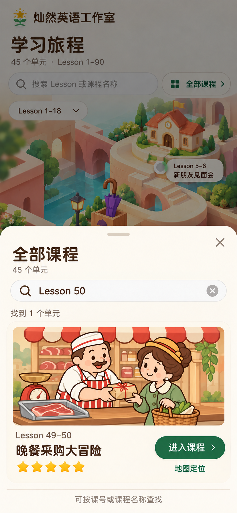

# 补充稿、提示词与核验记录

日期：2026-10-20。使用内置 `image_gen.imagegen`，没有使用 CLI／第三方 API。两张图片均已复制进项目，保留生成器原始文件；没有裁切、拉伸或重新编码。

| 补充稿 | 用途与实际尺寸 | 本次完整提示词 |
| --- | --- | --- |
| [桌面首页](desktop-home-v1.png) | 1440×1024 逻辑视口目标；实际图片 1487×1058。左侧目录与当前课程，右侧同一环境的宽幅地图。 | [desktop-home-v1.prompt.txt](desktop-home-v1.prompt.txt) |
| [手机搜索结果](mobile-directory-v1.png) | 390×844 逻辑视口目标；实际图片 853×1844。目录中查找 Lesson 50，结果为 Lesson 49–50。 | [mobile-directory-v1.prompt.txt](mobile-directory-v1.prompt.txt) |

[generation-log.json](generation-log.json)保存输出图哈希、提示词哈希、输入参考顺序、工具和原文件名。每张图另有 `.receipt.json` 回执。以上是补充概念稿；**唯一已获用户认可的视觉母版仍为原手机图**。

## 人工对照

本轮将原认可图、桌面稿和目录稿放在同一组输入中查看：

- 人物：桌面男士的圆眼镜、棕发、蓝绿外套与黄领带，女士的帽子、珊瑚外套与黄围巾，以及红色手提包均延续认可稿；没有改为三维黏土角色。
- 环境：宽屏稿仍是奶油石路、浅珊瑚拱桥、陶土屋顶、青绿色水面与暖左上光照。学校、雨伞亭和首课广场之间的空间关系保留；新增部分主要是宽屏连接地形。
- 目录：Lesson 50 对应 Lesson 49–50「晚餐采购大冒险」，使用该课真实屠夫与 Mrs. Bird 的参考图；没有把首课男女错用到该课。
- 文案：三处课程编号和名称可读，目录的直接进入与地图定位区分明确。
- 数据：效果图使用演示五星；生产页面须由真实数据绘制星数和状态。
- 图像细节没有逐像素一致：这是生成模型的补充演绎，不是原素材的机械复制。后续有完整一致要求的角色／环境优先复用已确认素材。

## 尚需实现阶段验证

- 桌面稿的左栏视觉比例比 340px 的初始布局目标更宽；代码落地时按真实文字和可用地图宽度调整，而非拉伸图片。
- 搜索图展示查询完成、键盘收起时的结果。实际目录层须随可用高度和键盘调整，不能照搬截图固定高度。
- 原稿的中性灰节点只代表未选中；生产界面应以可点击状态、绿描边和辅助名称避免被理解为锁定。
- 点击范围、键盘焦点、读屏、真实手机软键盘、动态效果和资源性能均未由静态效果图验证。
- 环境底图与透明人物配方已固化，尚未生成和验收生产分层素材。

## 生成包验证

[verification.json](verification.json)记录生成包校验、五种配方的确定性组合、课程快照检查和本轮实际检查范围。它只验证生成输入和归档一致性，不把页面功能标记为通过。

