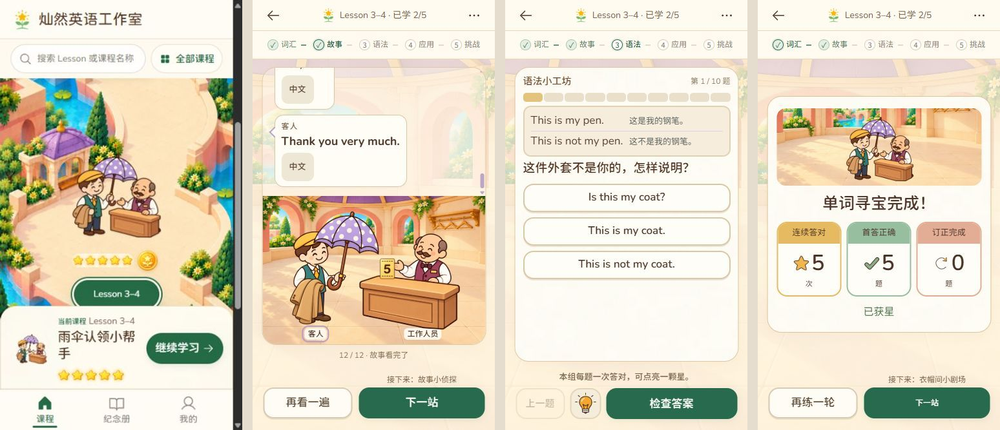

# Lesson3–4 首页到课堂的统一视觉样板

2026-11-01 · `codex/book-version` · 本地开发，未提交、推送或发布。

## 采用方向

以首页认领亭为美术基准：外景入口→认领亭内部剧场→清楚的纸面任务→同场景的三卡结算。没有改变原续学落点或强制重看课文。首页原图保留，课堂使用同角色的新动作、同地点近景及独立道具；答题页用淡环境衔接，题目文字仍在不透明纸面上。

新增素材与全部实际提示词见[认领亭固定包](../../../assets/unit3-4-journey/README.md)。九张采用WebP为862980字节，源PNG单独保留，不进入课程资源清单。人物、环境、柜台、外套、寄存牌和三把辨认伞分别生成；生成后的格式转换没有重绘、手工改色或删除原稿。

## 保持边界

Lesson3–4仍为33题、12句课文。`content.js` Git对象仍为`b26c60e64b115099f9d5d37f83018accbc4e65bb`，原纪念卡`assets/awards/unit3-4-umbrella.webp`仍为`097683c45934a620f42e2b2b0e0ef0f9ad5b6529`。首页角色组仍为`9f0536e40427d1ed5eca0edbe532d92d2bd25741`，首页环境仍为`aff280e7503aa7d0498754a8aad19ff602b9134a`。

没有改题目、答案、版本、奖励条件、学习存储键或服务器数据结构；原纪念卡及历史证书继续引用原资源。封面和完成区改用首页已认可角色组，不能将这项变化误称为重做纪念卡。其他课程没有接入本次美术。

## 实现与首错

- 课文对白作为真实UI放在画板上方，容器透明，只有独立气泡有纸色。下方完整3:2环境与人物／柜台／交接物共享坐标；不随长短句或选中状态重新布置人物。
- 柜台答题场景保留固定对白区，人物和道具按同画板缩小。首轮把对白另放在画板外，导致SE与320压力屏选项越界；真实33题检查保留失败后改为固定分区，最终严格断言通过。
- 首轮视觉对照发现整片白色对白背景仍显得割裂，已去掉整片纸面，让环境轻透出；同时用首页星花品牌替换不清楚的照片缩略标记。
- 伞杆、外套与手掌按实际透明图的握点和可见边界定位；在红／黄／紫／领回四状态分别核对。寄存牌始终为5，错误认领仍否认原来的那把伞。
- 功能测试通过后，逐图发现认领前外套悬在台侧；将其顶部光学支撑点投影到台面，随后又纠正同组红伞遮住工作人员脸的问题。新增真实图像`object-fit`下的台沿接触及面部避让断言，三设备重新截图；不能以“都在容器内”代替支撑关系正确。
- 新测试第一次误用了旧存储键，第二次同时匹配了课内卡与奖励卡；修正测试为当前配置键及明确的课程卡范围，未改产品记录或删奖励卡迎合断言。两次失败保留于`output/test-unit34-journey-first`、`test-unit34-journey-second`。

## 验证

Chromium按去重范围9项通过：新增视觉专项三种必测手机、Lesson3–4全33题／279个答前答后布局样本、三个扩展手机流程、订正重练与原记录保持、全部词卡和桌面课文。新视觉专项还覆盖三把伞时序、独立画板比例、人物完整、真实得星、原纪念卡和原稿访问保护。课中顶层加载遮罩为0。

最后涉及绘制的修改后，新视觉专项三设备再次通过；未改变的扩展流程复用本轮先前结果。首轮画面与布局失败保留，不当作通过。Node设备、包清单、伞颜色／轮廓和工作流30项通过；72个受保护单元构建通过。

WebKit对应9项全部通过，覆盖同一33题／279个布局观测、三种必测手机的课文／恢复／视觉流程、词卡、桌面课文和订正结果；课中顶层加载遮罩同为0。Chromium与WebKit共同覆盖558个全题布局观测，重复复验不累加成新的独立用例。

最后道具接触修正后，Chromium再次复验全部33题及三设备视觉；光学接触／避脸断言在两引擎分别三设备复验。新增断言时的一处测试括号语法错误在枚举阶段修正，不是产品失败，也不计入执行用例数。

必测视口为SE375×667、14/15 Pro Max430×932、16 Pro Max440×956，另保留320×568及390×844／768×1024／1366×768题区入口，1435×1244课文。没有运行全量CI、实体手机、微信／夸克、软键盘、完整旧证迁移或全部GIF导出；本轮不据此宣称全部通过。

已运行`npm run check:plan`；当前工作树含前轮未提交成果，共327个变更路径，本轮按上述相关范围执行，未运行整个`check:commit`计划。

## 实际画面对照

原生应用内浏览器从首页进入当前课程，读取原演示账号的课文、题目和已存结算，无作答或重练操作，控制台无错误。数据与现有card-key未重置。

图中顺序为首页、剧场、题目、结算。全部为375×667 CSS视口；首页截图接口返回360×640像素，其余为375×667，派生对照图仅归一到同CSS尺寸并排，没有裁切／重绘。原文件与[尺寸元数据](evidence/unit34-journey-v1/comparison-metadata.json)一并保留。

最终预览：[Lesson3–4剧场](http://127.0.0.1:4205/unit3-4/#learn/text)。上方四联图为4203同一账号画面，最后修正只影响认领前道具，与该四联图状态无差异；新4205原生[柜台画面](evidence/unit34-journey-v1/05-counter-contact-final-se.jpg)确认衣物搭台沿、伞不遮脸。独立绘制验收见根目录[design-qa.md](../../../design-qa.md)，现行规则只维护在[教学统一标准](../../butcher-version/publish/2026-10-24-2200-v1.55-教学单元设计标准与验收清单.md)。
