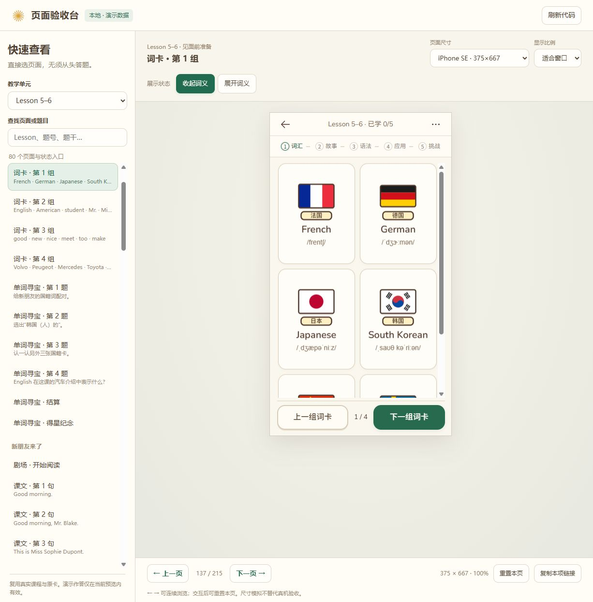
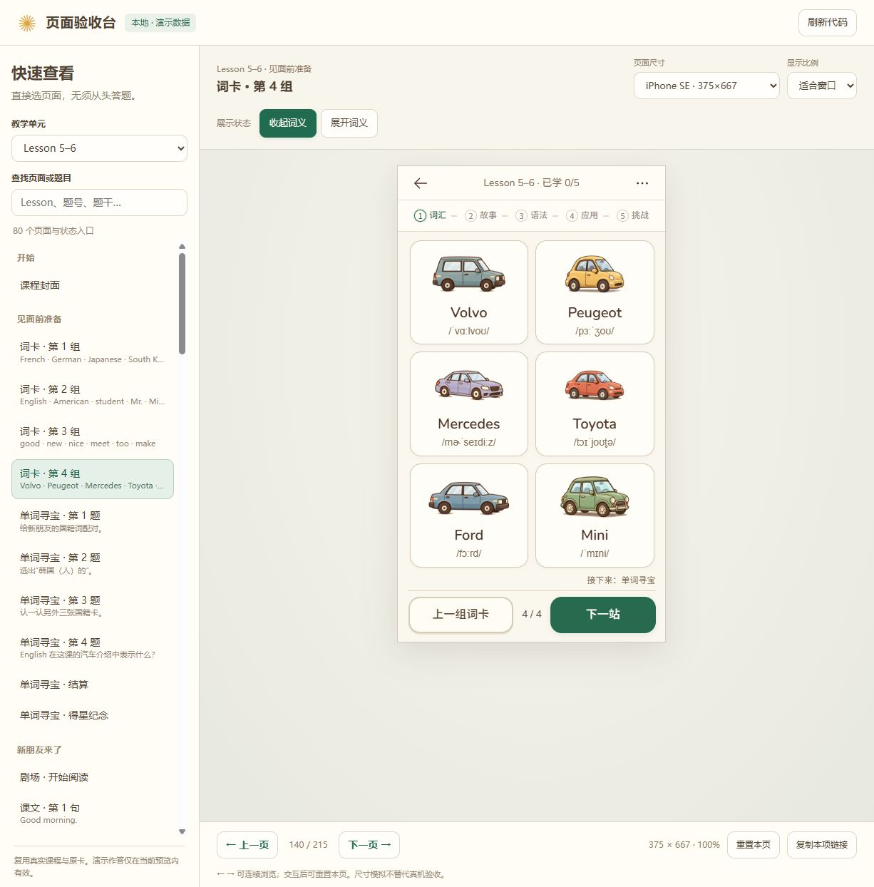
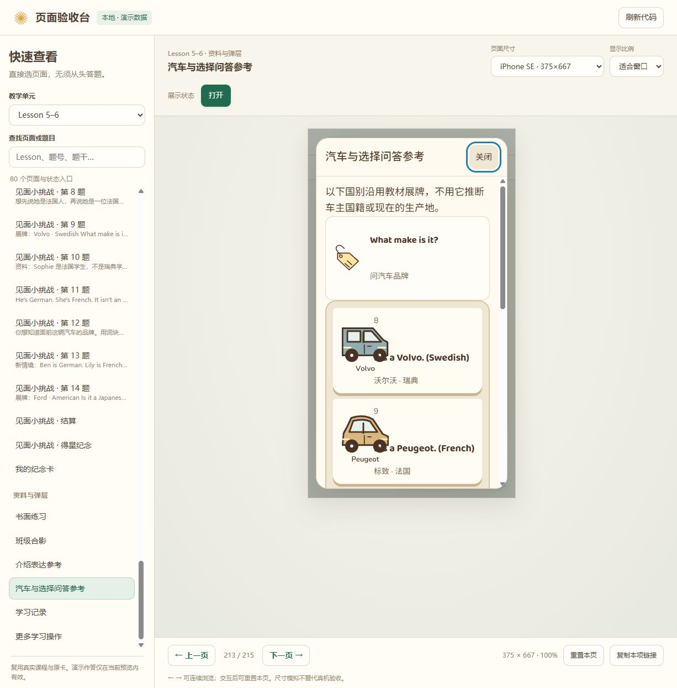
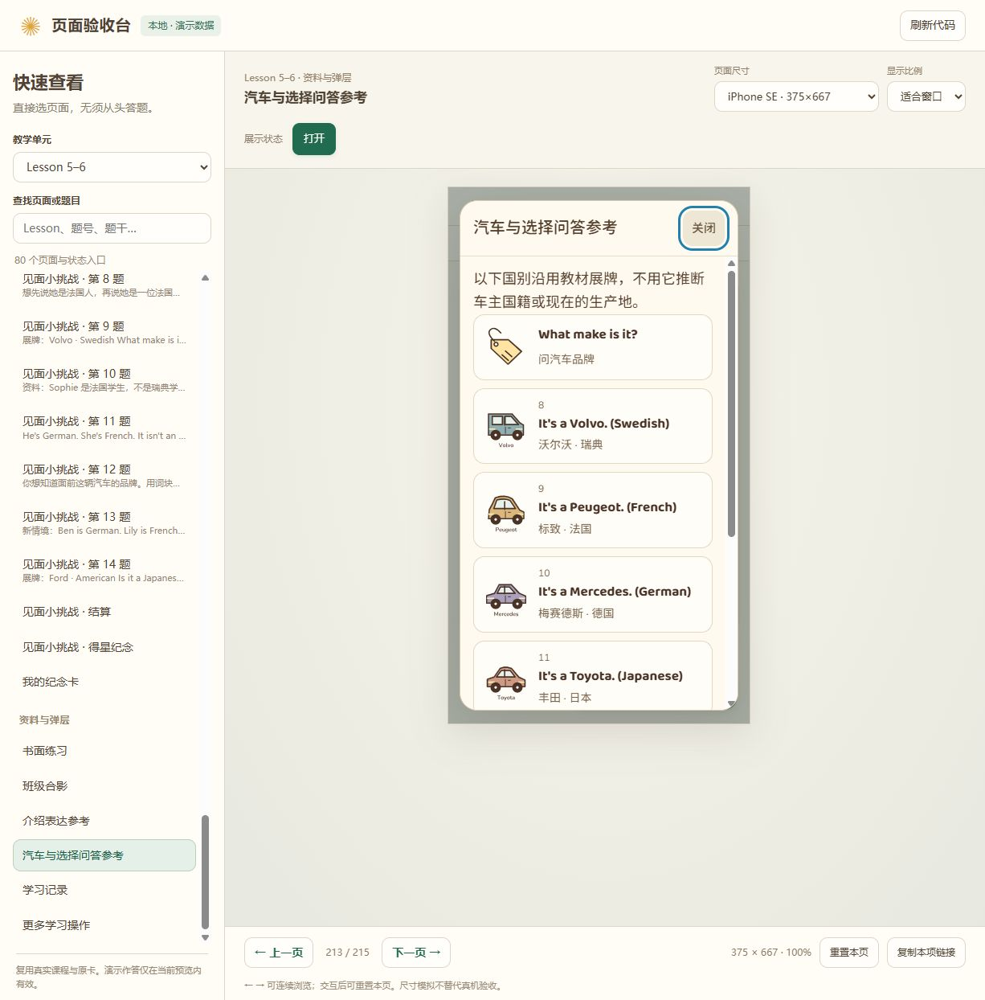
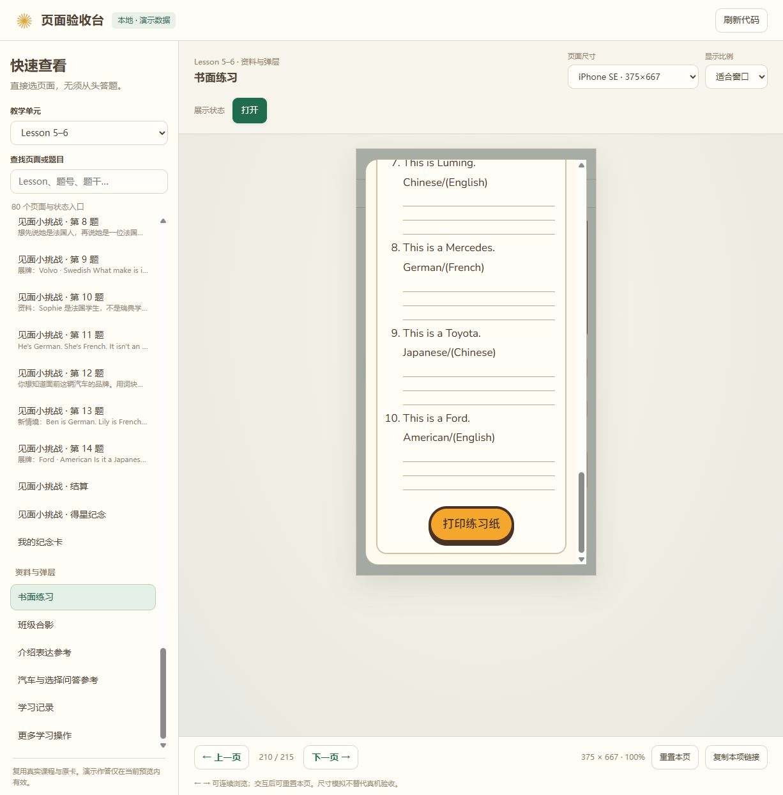
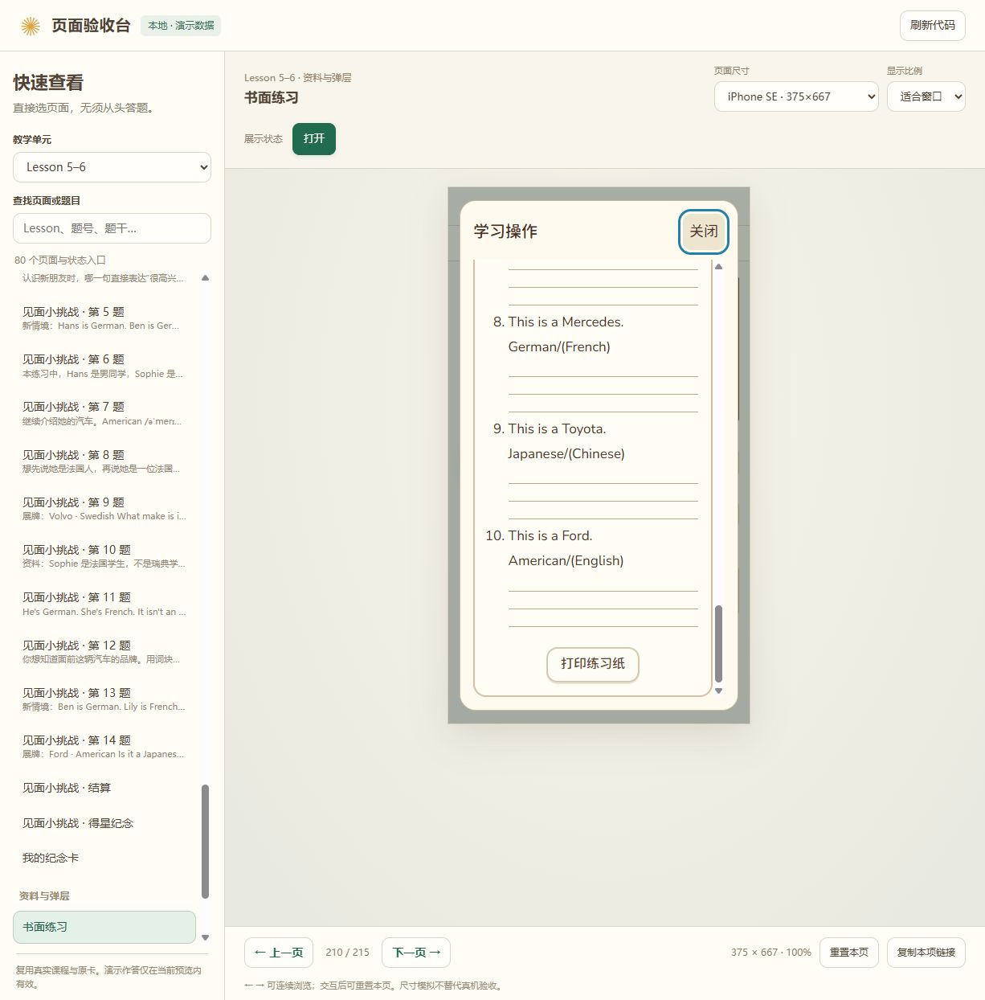

# Lesson1–6完整页面复查与修复

2026-11-08启动的复查 · `codex/book-version` · 本地完成，未提交、未推送、未发布。

## 结论与范围

按现行统一设计标准完成三单元各类页面复查，修复7类问题。题目、判分、获星、卡面素材与学习记录保持原规则；新增改动集中于呈现层和练习纸弹层的原打印动作连接。

目录包含215个入口：3个封面、13组词卡、39句课文及首尾状态、106题、15组结算／得星、3张课程纪念卡和各类资料／记录／菜单。复查组合为实际答题、各类页面状态矩阵、当前运行截图和逐帧切换检查，不宣称人工逐一审阅了215入口的所有状态组合。

固定手机为Chrome预设对应的iPhone SE375×667、iPhone14/15 Pro Max430×932、iPhone16 Pro Max440×956，单位CSS px。另保留320×568、平板、电脑与短横屏检查。

## 按使用顺序的复查

| 步骤 | 页面与任务 | 当前状态 | 依据 |
| --- | --- | --- | --- |
| 1 | 封面→开始／续学 | 正常；图文连贯、主按钮有底部留白 | 当前三课固定手机与压力尺寸检查；[封面](evidence/2026-11-08-full-audit/01-cover.jpg) |
| 2 | 全部词卡组→展开词义→下一组 | 已修复；六词完整、末组也无额外滚动条，长例句可读 | 两引擎13组词卡与逐卡展开；[修复后](evidence/2026-11-08-full-audit/02-words-after.jpg) |
| 3 | 剧场阅读、中文、最后一句、进入练习 | 正常；人物、雨伞／外套／手提包位置保持 | 39句真实阅读流程，认领亭三伞及柜台专项；[剧场](evidence/2026-11-08-full-audit/03-story.jpg) |
| 4 | 106题作答、错误反馈、订正、回看、讲解 | 正常；操作位置稳定，原记录保留 | 636个必测手机答前／答后样本无溢出，底部间距至少17px；[题目](evidence/2026-11-08-full-audit/04-question.jpg)、[错误反馈](evidence/2026-11-08-full-audit/04-feedback.jpg) |
| 5 | 各组结算、得星弹层及返回 | 正常；统计和主操作完整，原奖励门禁保留 | 15组全对／订正结算×三手机；每课1星／5星原卡；[结算](evidence/2026-11-08-full-audit/05-result.jpg)、[得星](evidence/2026-11-08-full-audit/05-award.jpg) |
| 6 | 纪念卡、保存与课程出口 | 已修复空反馈留白；出口仍只在纪念卡页 | 双引擎卡片／课程导航及首次／重复进入颜色检查；[纪念卡](evidence/2026-11-08-full-audit/06-card.jpg) |
| 7 | 参考资料、学习记录、设置 | 已修复参考图文、卡片高度与重复列表标记 | 六类资料、逐层展开及关闭，真实账号设置／回焦／记录保护；[参考](evidence/2026-11-08-full-audit/07-reference-after.jpg)、[记录](evidence/2026-11-08-full-audit/07-records.jpg) |
| 8 | 书面练习、滚到底部、打印与退出 | 已修复；关闭常驻，打印原内容完整并恢复状态 | 三课三手机及两引擎打印媒体检查；[练习纸底部](evidence/2026-11-08-full-audit/08-worksheet-after.jpg) |

## 发现与修复

1. **词卡固定高度造成第三排隐藏。** Lesson3–4为176px，Lesson5–6为208px，SE的一组内容超出可用区域。三行按真实内容高度分配，保留各课大屏上限；插图可伸缩，末组下一站提示也纳入预算。折叠态检查零溢出及英文／音标实际边界；长例句展开后允许必要的卡内滚动，分页不动。
2. **参考条目继承旧最小高度。** 152px最小高度产生约53–70px无内容空间。参考模式显式重置高度、行列、内边距及旧展板外框，英文和释义自然相邻。
3. **汽车参考图压住文字。** 原105px图片进入56px图片列，编号又自动占用文字行。现在图片区限于自己的列，编号／英文／中文分行，独立提示卡与后续列表之间保留10px间隔。
4. **纪念卡的空反馈间距叠加。** 导航到练习区实测61px，来自空反馈高度及相邻margin。保留20px单行反馈、收紧边距，总间隔32px；主操作不因反馈出现而移动。
5. **学习记录出现双重列表标记。** 默认圆点位于分组外框边上，同时已有展开箭头。取消外层圆点，保留原详情与箭头，不改记录内容。
6. **长练习纸把关闭滚出屏幕。** 整个菜单滚动，初次定位及滚到底部时关闭按钮离开视口。改为固定标题／关闭、正文独立滚动；编号留在框内，打印按钮统一为清晰的次要操作。
7. **弹层打印按钮失去动作，且原纸可能仍折叠。** DOM克隆没有复制监听器。现在转交原打印动作，临时展开真正用于打印的原练习纸；结束／取消后恢复原折叠状态。测试验证调用一次、打印版首末内容可见、菜单隐藏及状态恢复。

### 当前运行的前后对照

词卡修复前：

词卡修复后：

汽车参考修复前：

汽车参考修复后：

长练习纸修复前：

长练习纸修复后：

## 实际验证与证据

| 范围 | 本轮实际结果与位置 |
| --- | --- |
| 106题实际答题 | Chromium3项通过；共893个几何样本，其中三手机636个答前／答后样本全部零溢出。`output/lesson1-6-full-audit-baseline-questions/`；这些题目与答题布局未被后续阅读卡修复改变。 |
| 新增阅读／卡片矩阵 | Chromium9项、WebKit9项通过。`output/lesson1-6-surface-audit-strict-chromium/`、`lesson1-6-surface-audit-strict-webkit/`。 |
| 结算与得星类型 | Chromium3项、WebKit3项通过；各15组结算含全对／订正、三手机，另查每课1星／5星。`output/lesson1-6-page-types-current/`、`lesson1-6-page-types-webkit/`。 |
| 封面与人物道具／出口颜色 | Chromium12项通过；含三手机、320px、平板／电脑、重复进入。`output/lesson1-6-audit-cover-scene-current/`。 |
| 真实流程与防闪烁 | Chromium18项、WebKit12项通过；图片保护、逐帧题目切换、原数据、认领亭道具、减少动态及设置。`output/lesson1-6-audit-flow-final/`、`lesson1-6-audit-flow-webkit/`。 |
| 练习纸与打印 | 两引擎共8项通过；打印版内容的最终2项复验在`output/lesson1-6-worksheet-print-layout-final/`，首尾关闭检查在`lesson1-6-worksheet-final/`。 |
| 最后菜单回归 | 两引擎各1项通过，三个手机尺寸设置和回焦均检查。`output/lesson1-6-final-menu-chromium/`、`lesson1-6-final-menu-webkit/`。 |
| 自动检查选择 | 32项通过；新增`browser-mobile-surface`和WebKit任务，覆盖阅读、卡片、各类结算和练习纸。 |

失败证据保留在`lesson1-6-surface-audit-before`、`lesson1-6-surface-audit-strict-before`、`lesson1-6-worksheet-before`、`lesson1-6-worksheet-print-before`及`lesson1-6-worksheet-print-layout-before`。首次词卡检查沿用2px容差，目视发现1px也会出现滚动条，随后改为零溢出并补测卡面文字；没有通过隐藏内容或放宽检查掩盖问题。旧WebKit批次在收紧检查时主动中止，最终采用strict批次结果。首次浏览器局部裁剪抓错区域已拒收，报告仅使用本轮重新捕获、保存并目视确认的完整截图。

旧学习流程用例仍把“已完成但未获星”视为绿色对号，本轮按用户已确认规则修订为0个获星勾，另外保留“已学1/5”断言；没有为迎合旧断言改变产品规则。

## 边界与交付

这是本地源码与隔离测试账号的检查。未运行全站／72单元全量CI，未做实体iPhone、安卓微信／夸克、系统键盘／真实安全区、物理打印机或读屏器验收，不宣称完整可访问性合规。打印仅验证浏览器调用和打印媒体下的真实内容，未发出物理打印任务。

交付使用本地验收台`http://127.0.0.1:4401/`；重点查看Lesson5–6词卡、汽车参考，以及三课书面练习底部的关闭／打印。没有提交、推送或官网发布。
