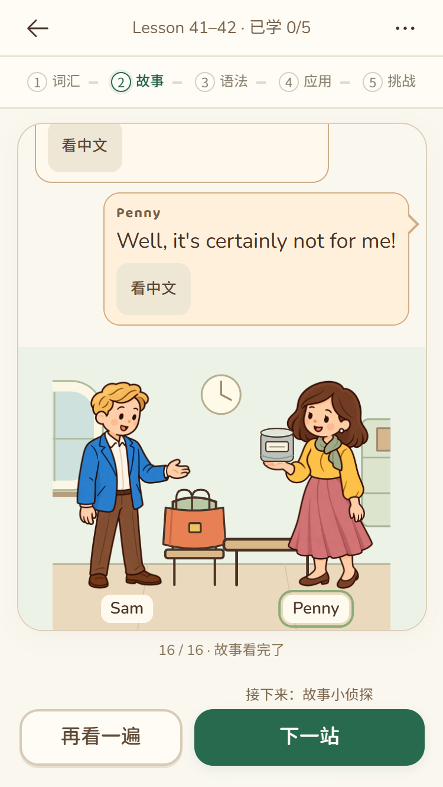

# Lesson 1–144 完整学习界面统一

> 同日后续纠正：本记录证明的是共用界面、功能和布局推广；全书词卡插画风格统一并未完成。用户反馈后，确认1,755条旧SVG仅改填色，不能作为美术通过。当前首组六词的实际重绘和后续验收规则见[词卡美术复核](../word-art-v2/README.md)。

用户确认范围为全部72个教学单元的词卡、剧场、答题、结算与课程内纪念卡，而非仅调整词卡边框。实现位于`codex/book-version`；提交、推送和发布分别记录，不由本记录推定官网已更新。

## 共用界面与保留边界

- 全部单元接入48px课程导航与44px五阶段入口。已学数量来自原完成事实，绿色对号来自对应环节的真实获星。
- 题目使用持续纸面、固定反馈／操作区、中间灯泡与只读上一题。当前错题仍可订正，错误次数、帮助记录和首答事实保留。
- 词卡每组六词，翻组常驻；展开保留英文、音标、中文和原例句。长词优先让插图让出空间，不裁切文字或隐藏滚动问题。
- 剧场对白和画面分别拥有空间；原人物、道具、交接时机、全文及阅读门禁不变。最后一句的“去练习”在原控制器确认阅读完成后沿用原下一站路由，不再多点一次。
- 结算使用连续答对次数、首答正确题数、订正完成题数；原实际提交账本不改。短按钮旁说明目的地，综合挑战到“查看纪念卡”后才显示课程出口。
- 学习记录、153个原有参考资料面板和练习纸统一使用可关闭、可滚动的面板。长资料保留全文，关闭控件固定。

实施前固定了72课内容源码、4,329题、1,909个词条、题稿版本、奖励定义及原纪念卡画面的校验基线，见`tests/fixtures/learning-shell-content-contract.json`。检查必须与该基线比较，不以重新生成基线掩盖修改。

## 本次发现的扩展陷阱

| 问题 | 根因 | 固定规则 |
| --- | --- | --- |
| 只读回看在后续单元失效 | 共享界面已载入，但课程挂载仍使用旧的关闭回看选项 | 接入清单包含控制器选项；不能只检查CSS／脚本引用 |
| 人物顶部或桌椅被裁切 | 旧剧场为对白预留大段内边距，新的画面槽又限定高度 | 清理旧对白占位；人物、地面和道具作为一个画板适配 |
| 厨房、客厅与办公室的内层画板越界 | 按宽度撑开的图片或比例画板并不会因缩放外层而变矮 | 内层图片／人物／热点同框按完整比例约束；禁止只缩图片而不移动热点 |
| 切到结算后页面横向溢出 | 隐藏剧场保留上一尺寸的拟合宽度，仍参与溢出计算 | 非活动关卡隔离溢出；“隐藏”不等于不影响布局 |
| 长词块超出圆角框 | 三列答题槽统一44px，后来课程包含多行短语 | 按该题全部候选词块预留最大行高，选择前后保持同样高度 |
| 交接题需要长距离滚动 | 三名接收者在旧手机样式中纵向排列，大图与重复状态占空间 | 物品与接收者各一排，人物、道具同框，去掉重复操作提示 |
| 普通小场景占半屏 | 非交互的情境记录仍按完整剧场尺寸展示 | 辅助情境使用紧凑图文，动态数量和原材料保留；交互场景不能套此规则 |
| 长词卡出现细滚动条 | 固定图片高度与多行英文／音标争夺卡内空间 | 图像等比让出空间，文字不缩减；用真实滚动高度和截图同时检查 |
| 参考资料继承大卡片尺寸 | 原参考卡片结构与前3课不同 | 图片／编号／正文分栏，不照搬一个单元的子节点选择器 |
| 人物完整但对白不可见 | Lesson41–46把对白再包在reader内；仅适配直接子节点会留下零高包裹层 | 白读区和操作栏归位，并检查当前对白实际可见；父容器／图片边界通过不能代替这项检查 |
| 森林告示在320小屏越界 | 原画板保留420px对白预留偏移 | 叙述者与原告示分配同一画面内的比例区域，保留告示切换与原图 |

短屏（可用高度不超过700px）中，较大的**非交互情境图**使用带缩略图的“查看完整情境”入口，展开后显示原始完整图文及当前数量／道具状态，关闭返回原题和原焦点。交互地图、热点、选择项不收拢到该面板；不删题干，不改变答案或学习记录。较高手机、平板与电脑仍直接显示情境。极长阅读和多空题允许内容区域滚动，反馈与操作栏保持固定，不宣称全书每道长题都无需滚动。

## 词卡素材处理（历史实现，已撤销其画风统一结论）

以第4.1节为验收依据。保持既有教学图形的识别意义，复用已采用的伞、外套、汽车及适用人物素材；其余原生SVG在保留轮廓、文字、位置和数量的前提下统一暖色光照、柔和明暗。国旗与嵌入的原画保留；Lesson5–6既有采用素材优先。原素材和原纪念卡均不覆盖。

上一轮没有调用图像生成来批量重画词条。其渐变派生仅是材质调整，无法修正旧图标造型，历史记录留在`assets/learning-words/receipt.json`。脚本现已改为只编译明确审核的采用清单，不再批量生成渐变来充当完成；各单元的`learning-artwork.js`仍只改变显示映射，不写入词库或答案。新六词图使用原纪念卡参考逐张生成，提示词、原稿与页面对照另行保存，不能与本轮历史布局通过记录混记。

## 本地验收台

`npm run preview:review`打开全部72个单元与6,961个页面入口，可按Lesson、题号、题干搜索。保留状态按钮、跨题沿用状态、三种Chrome手机尺寸、320压力、平板与电脑。课程内切题同步当前目录，切换题目／状态尽量复用已加载页面；仅演示内存状态重置，不连接账号数据库。

本地已打开[Lesson7–8验收入口](http://127.0.0.1:4401/?unit=unit7-8&page=cover&state=view&device=chrome-iphone-se&stars=5)，确认72个单元可选、封面可进入词卡、词义可展开。[打开时截图](evidence/2026-11-09-whole-book/preview-bench.jpg)。

自动浏览器测试固定服务启动时的构建，避免测试期间文件修改让同一份报告混入多个版本。日常验收台的“刷新代码”继续重新构建。

## 验证记录

实际执行结果如下；逐单元数量见[验证台账](2026-11-09-whole-book-validation.md)。后续修复按影响范围复测，未把所有早期通过记录冒记为最终代码的一次全量运行。

| 验证范围 | 实际结果与证据 |
| --- | --- |
| 教学／素材／目录合约 | Node合约与工作流40项通过；最终8项核心合约再次通过，72课原内容、版本、答案、奖励和原卡校验一致 |
| 全书题目与逐句剧场 | Chromium144项通过，覆盖4,329题、12,987个必测手机布局样本、924句课文与2,772个姿态样本；后续69课情境／对白调整追加138项通过 |
| 全书页面类型与词卡 | Chromium72项通过，1,348个页面入口、4,044个手机尺寸样本；1,909词条折叠／展开及全部原参考资料可达；最后一课布局另追加2项通过 |
| 短屏完整情境 | 独立面板、关闭焦点、原题记录与高屏展开方式通过；Chromium定向11项、WebKit补测包含3项情境检查 |
| 真实账号 | Lesson7–8、41–42、143–144分别在三档必测手机尺寸完成实际挑战、回看、刷新续做、授星、结算与原卡，3项通过；未对全72课逐课创建账号 |
| WebKit | 原流程、状态切换、道具、首次与重复进入纪念卡颜色19项通过；最后对白／情境修复补测8项通过；未冒记全书WebKit逐页覆盖 |
| 320／平板／电脑 | 7–8、27–28、41–42、49–50、81–82、143–144，320×568／768×1024／1366×768；首轮最后一课森林图越界，修复后该课独立复测通过 |

首轮保留了人物裁切、固定词块高度、隐藏世界横溢出、reader对白零高和森林320越界的证据。早期账号脚本的选择器错误、回看关闭选项、原卡多元素匹配均有独立修正，不把脚本错误写成产品判分错误。

三档必测尺寸为Chrome预设的iPhone SE375×667、iPhone14/15 Pro Max430×932、iPhone16 Pro Max440×956；测试复用统一清单。合并最后情境补测后，仍有99个长内容布局样本使用内容区滚动，详见[实际边界](evidence/2026-11-09-whole-book/scroll-boundaries.json)，不宣称每道长题全部内容均在一屏。人工图像复核与自动几何检查分别判断，未把统一矢量材质声明为全部插图重绘或逐张美术终审。

自动尺寸模拟不等于实体iPhone、Android微信／夸克、键盘和安全区验收；这些实体条件本轮未测。无关全站CI、打印设备实测与生产发布均未执行。

主要本地日志目录为output/learning-rollout-final-questions-stories、learning-rollout-final-pages、learning-rollout-final-context-stories、learning-rollout-login-verified、learning-rollout-webkit、learning-rollout-webkit-followup、learning-rollout-woods-final。

定向检查入口：

- `tests/unit/learning-rollout.test.js`：全72课接入、资料目录、教学与奖励基线、矢量教学几何保持。
- `tests/review/rollout-audit.spec.js`：4,329题在375×667、430×932、440×956的文本、按钮、图片和滚动边界。
- `tests/review/rollout-pages.spec.js`：封面、全部词卡／展开、剧场、五区结算、原卡、资料、练习纸和记录面板。
- `tests/review/rollout-stories.spec.js`：逐句原文、人物道具姿态、图片就绪与最后一句一次进入练习。
- `tests/login/learning-rollout.spec.js`：隔离账号真实作答、回看、刷新续做、授星、题数结算与原卡。

尚未提交、推送或部署。本次不运行与学习界面无关的全站CI。
