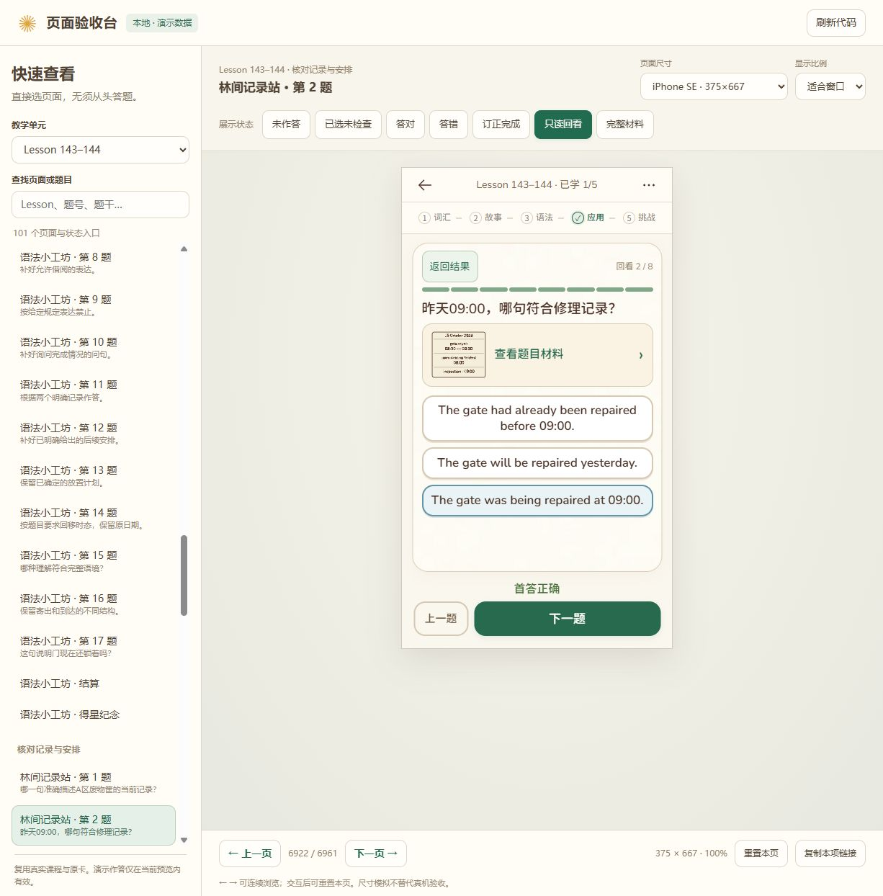

# 词义居中、故事气泡与题目材料排版修复

2026-11-10，基于用户提供的city词卡、Lesson1–2故事样板，以及Lesson143–144故事和修理记录题截图。分支为`codex/book-version`。

## 根因与处理

| 问题 | 实际根因 | 修复 |
| --- | --- | --- |
| 展开词义靠上 | 手机样式固定为`justify-content:flex-start`，短释义没有居中机制 | 通过等量弹性留白居中整组英文、音标、中文和例句；内容过长时留白自然归零，首行从顶部开始并可滚动，不被居中挤出边界 |
| 故事与Lesson1–2不一致 | 后续单元的中文按钮独占一行，气泡缺少统一层级；树林背景仍画在独立下半区，源SVG的矩形边线形成分隔 | 共用故事气泡改为姓名／“中文”同排，英文和译文依次在下；保持完整译文与44px触控范围。作者气泡在左、告示在右。树林背景延续到同一画框，保留原背景元素、人物与地面的坐标，去除内部矩形边线 |
| 进度条挤到题干 | 实测容器高6px，内部色块高14px，色块越界8px；紧凑规则又只留下6px间距 | 色块高度跟随容器；进度与题干保留12px间隔。公共布局检查新增进度色块不能超出容器的断言 |
| 记录题堆叠且多处滚动 | 英文材料、通用“林间核对记录”入口、实际记录图重复占位 | Lesson143–144两道长图文记录题使用一个“查看题目材料”入口；打开后保留原图、全部原文字和固定关闭按钮；题干和全部选项留在主界面。其他情境入口继续按原规则显示 |

没有修改`content.js`、答案、题库版本、评分规则或原纪念卡。打开／关闭材料不改当前答题组记录；人物素材和原故事顺序保持。背景派生SVG只去除外层矩形描边，前景仍按原画板定位，避免为了连接阅读背景而重排人物或拉伸场景。

## 本地验收入口

- [展开词义](http://127.0.0.1:4401/?unit=unit143-144&page=words-0&state=expanded&device=chrome-iphone-se)：进入后也可点city单独展开。
- [故事第8句](http://127.0.0.1:4401/?unit=unit143-144&page=story-7&state=english&device=chrome-iphone-se)：检查姓名、中文按钮、原场景及译文。
- [修理记录题回看](http://127.0.0.1:4401/?unit=unit143-144&page=q%3Au143144-v1-a-past&state=review&device=chrome-iphone-se)：题干、材料和选项不再互相挤压。
- [完整材料状态](http://127.0.0.1:4401/?unit=unit143-144&page=q%3Au143144-v1-a-past&state=full&device=chrome-iphone-se)：直接查看原图和原文。验收台选择该预设后，下一道支持此状态的题会继续打开自己的材料。

## 实际页面对照

[修复前题目](evidence/2026-11-10-layout-refinement/01-crowded-before.jpg) · [Lesson1–2参考](evidence/2026-11-10-layout-refinement/02-lesson1-reference.jpg) · [词义居中](evidence/2026-11-10-layout-refinement/03-words-centered.jpg) · [连续故事画框](evidence/2026-11-10-layout-refinement/04-continuous-story.jpg) · [完整图文材料](evidence/2026-11-10-layout-refinement/05-complete-material.jpg)

## 实际验证与边界

固定清单中的iPhone SE375×667、iPhone14/15 Pro Max430×932、iPhone16 Pro Max440×956均参与检查。

- 首轮9项检查复现三个问题，修复后通过；新增材料预设继承用例先捕获错误的“查看全文”入口，修正后通过。
- Chromium最终13项：三种尺寸的三类问题、材料预设，以及Lesson7–8／41–42／143–144原故事逐句与人物边界。
- WebKit10项：三种尺寸的三类问题和材料预设。本轮能够打开页面，和此前独立词卡任务的启动失败分别记录。
- 原词卡回归3项：Lesson1–6全部词卡组、每张展开与翻组，在三种尺寸通过。320×568另验证长释义首行、材料关闭、故事译文和底部操作可达。
- 影响面回归6项：Lesson1–2、7–8、143–144的152题共456个手机布局样本，以及保留的情境弹层。没有文本越界或进度条溢出；4个既有长内容样本仍使用内容区滚动，不能据此宣称每道长题都无需滚动。
- 教学、资源和验收台合约13项通过；工作流33项通过。新`browser-layout-refinement`和对应WebKit任务已加入影响性检查映射。

日志分别在`output/layout-refinement-before`、`layout-material-preset-before`、`layout-refinement-regression`、`layout-refinement-final`、`layout-refinement-webkit`、`layout-word-center-regression`、`layout-refinement-impact`及`layout-refinement-pressure`。模拟尺寸和引擎不等于实体iPhone、微信／夸克、键盘或安全区测试；本轮未做实体机、完整全站CI、提交、推送或发布。

本次处理的是布局与交互，不改变[词卡美术待审范围](../word-art-v2/README.md)，也不据此宣称全书插画风格验收完成。
