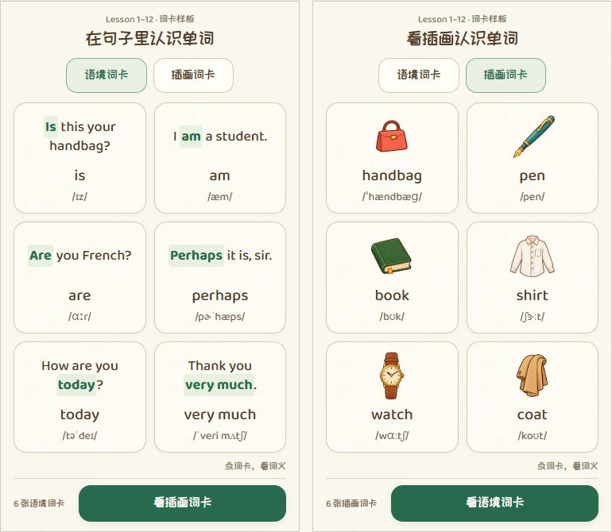

# 六词语境卡样板（设计已确认）

2026-11-14后续：已将认可方案接入Lesson1–12真实课程全部132词，详见[正式接入记录](2026-11-14-grouped-course-words.md)。下文保留最初独立样板的设计与验证历史。

2026-11-13用户已认可当前分组设计。下一阶段为正式接入Lesson1–12的132个词条；目前仍是独立本地样板，尚未替换真实课程词卡。

用户希望先看is、am、are、perhaps、today、very much的语境主导样板。**2026-11-13按用户要求调整：插画词卡与无图语境词卡各自集中成组，同一页不混排。** 本次仅在本地验收台增加设计样板，没有替换正式课程词卡、改动题库或写入学生记录。

## 查看方式

- [语境词卡](http://127.0.0.1:4401/?unit=unit1-2&page=sample%3Aword-context&state=collapsed&device=chrome-iphone-se)：is、am、are、perhaps、today、very much六张无图语境卡，突出完整短句中的目标词。
- [插画词卡](http://127.0.0.1:4401/?unit=unit1-2&page=sample%3Aword-illustrations&state=collapsed&device=chrome-iphone-se)：handbag、pen、book、shirt、watch、coat六张原插画卡。

两个入口位于Lesson1–2目录末尾的“设计样板”。“语境词卡／插画词卡”标签和底部切换按钮会同步外层地址，复制链接可直接打开对应分组。单卡可点击或按Enter展开／收起；外层状态按钮可以批量展开、收起，使用同一文档即时切换。尺寸选择沿用验收台的统一设备清单。

## 六个词的内容依据

| 目标词 | 展示短句 | 来源 |
| --- | --- | --- |
| is | Is this your handbag? | Lesson1–2原词条例句 |
| am | I am a student. | Lesson7–8原词条例句 |
| are | Are you French? | Lesson7–8原词条例句 |
| perhaps | Perhaps it is, sir. | Lesson11–12原课文 |
| today | How are you today? | Lesson9–10原课文 |
| very much | Thank you very much. | Lesson1–2原词条例句 |

原音标与中文释义直接读取课程定义。样板不把is一律解释为“是”，不把today画成早晨；目标短语very much作为完整词块保持同一行。图片卡复用已有采用图，不生成新图片。

## 呈现与实现边界

沿用暖纸、绿色强调、棕色文字、圆角与原字体。短句和插画共享卡片上半部，词名／音标位置保持一致；展开原释义时外框不跳动。手机六卡两列三行，宽屏三列两行；320px压力尺寸允许内容区滚动，底部操作保留。

样板的HTML、样式、交互与数据构建均在`review-bench/word-concept/`。验收服务只增加明确的本地GET路由和同源嵌入，生产课程包仍不含样板。样板读取原定义生成独立数据，不修改原定义对象、不调用账户接口、不使用学生存储。正式课与样板之间切换重建对应文档，样板内部及状态切换原地完成。

## 验证

`word-concept.test.js`检查六词、原音标／释义／例句来源、每组类型唯一、两组各六词、已审图片复用，以及原定义不变。`word-concept.spec.js`逐组拦截图片与语境混排，并覆盖所有卡片展开／收起、短语完整、键盘、无布局跳动、底部操作及样板往返真实题目。

必测尺寸为SE375×667、iPhone14/15 Pro Max430×932、iPhone16 Pro Max440×956，补充320×568、768×1024、1366×768。两引擎执行结果与首错分别存于`output/word-context-sample/`。首轮识别出样板返回真实题目误走快速状态通道及very much被断行；均有失败用例后修正。测试中的多元素定位和课程就绪等待也分别修正，未放宽几何检查。

最终Chromium／WebKit样板检查14项通过；原课程状态切换2项通过，均为同文档、零额外课程文档请求；原定义／本地只读边界／正式包排除等9项Node检查及34项检查流程测试通过。没有运行无关全站CI。

2026-11-13分组调整后，重新通过两引擎14项样板检查及5项本地样板／隔离契约。目录搜索、历史、复制链接和状态隔离也分别在两引擎通过；目录数量断言改为依据真实目录，复制失败时改验实际显示的手动复制对话框。首错保留，没有把浏览器不提供剪贴板权限误记为样板故障。

上图为本轮应用内浏览器中两个独立分组的并排截图，各组实际都是一屏六张，并非同一页混排。

本次设计已获用户认可；正式课程接入和全量词卡推广尚未完成。实体手机／微信／夸克未验，未提交、推送或发布。
