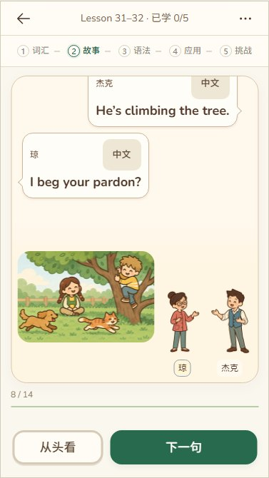
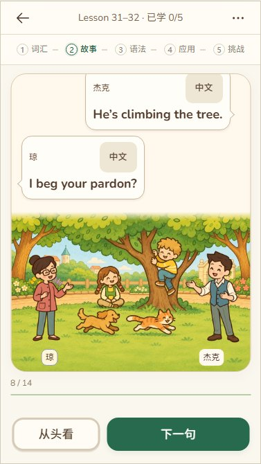
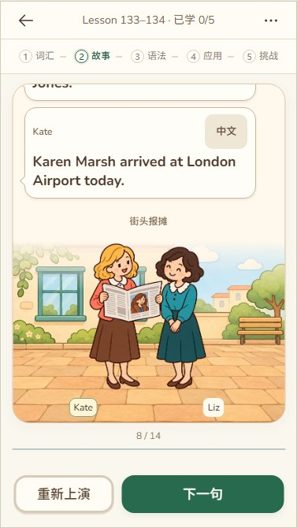
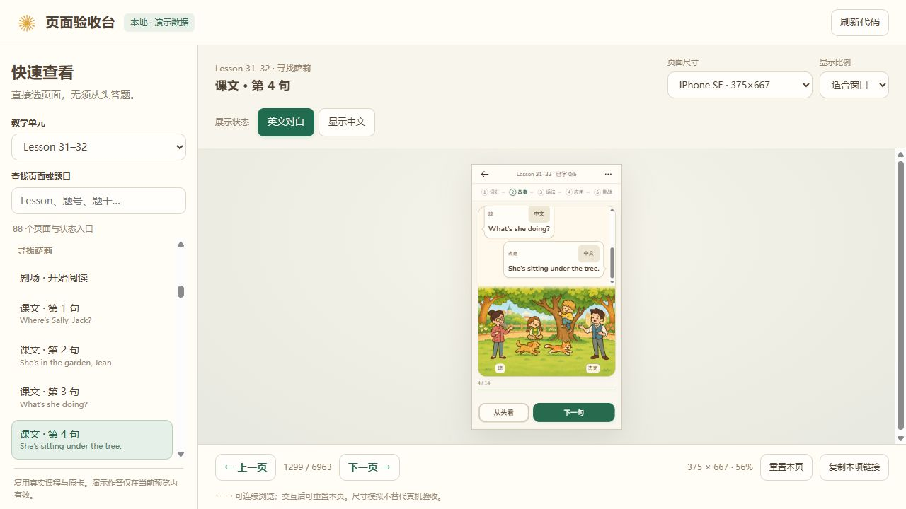

# 以 Lesson 1–2 为基准的全册剧场复查

2026-11-15 · codex/book-version · 本地修正与验收。下列影响范围验收完成；未提交、未推送、未发布。

## 范围与证据

复查全部72个教学单元、924句原文。每课采集开场、中段、末句，在iPhone SE 375×667、iPhone 14/15 Pro Max 430×932、iPhone 16 Pro Max 440×956三档CSS尺寸共648个初始页面截图；本轮实际基准为Lesson1–2本地剧场，不使用旧截图代替当前证据。逐课问题与最终状态记录在[复查台账](all-theatres-review.json)。

原文、题目和答案、原纪念卡及首次日期保持；阅读控制器、学习记录键和授星规则保持。新场景、家具和姓名排布在呈现层修正。原素材保留，完整事实画面与照片不裁剪、不复制样板角色、不改变颜色、数量与关系。

## 逐步检查与修正

1. **进入剧场**：检查完整画面是否直接承载故事、是否有多余内框。25–40的七个单元采用完整场景；31–32重新安排前景对话者与中景人物，25–26新厨房保留左蓝电炉、右白冰箱和中央一瓶一杯。27–28、33–40复用原完整横幅或原照片。
2. **逐句阅读**：检查人物比例、脚下地面与道具。5–6集体同学从小缩略网格改为地面上的错层站位；15–16同行朋友、19–20摊贩恢复可辨认尺寸。47–50的家具按人物高度封顶；55–56茶具／午餐和71–72电话增加真实桌面；65–66钥匙按原人物掌心与镜像状态定位。
3. **切换人物／场景**：129–142合成人物的姓名按实际绘制宽度排列，隐藏人物不占名字列，英文名字只在空格处换行。125–126的门和花圃融入完整花园；143–144原有数量记录和告示原文保留，树林、篮筐与散落物放在同一地面中。
4. **展开中文与改变尺寸**：对白区保持透明，文本独立于背景；检查人物、姓名、完整图片、操作栏和可滚动正文。320×568仍作为压力场景，另外检查平板与电脑。
5. **阅读完成与续学**：逐课实际点击到下一练习，核对原句和顺序。使用真实本地测试账号检查刷新、离开再回到课文、阅读完成后重新进入，确认原作答记录不变。

补充：WebKit在绘制时可能再次调整长对白高度。现在观察实际对白尺寸变化，保持末句可见；主动回看、滚轮／触摸和键盘滚动继续保留原位置。姓名和台面也按原图真正的可见边界校准，不能把透明留白当作人物站位或承托表面。

## 逐课审查结果

24个单元有针对性修正，另外48个保留当前构图并完成回归。不同人数、坐姿与带教学事实的照片不要求机械使用同一人物像素高度；必须保证语义、角色辨认、合理相对比例和清晰的操作。

| Lesson | 本轮处理 | 手机截图 |
| --- | --- | --- |
| 1–2 | 保留当前构图，逐句与响应式回归通过 | [查看](evidence/2026-11-15-all-theatres/unit1-2/middle-chrome-iphone-se.jpg) |
| 3–4 | 保留当前构图，逐句与响应式回归通过 | [查看](evidence/2026-11-15-all-theatres/unit3-4/middle-chrome-iphone-se.jpg) |
| 5–6 | 集体同学被压缩成过小的两排缩略人物 | [查看](evidence/2026-11-15-all-theatres/unit5-6/middle-chrome-iphone-se.jpg) |
| 7–8 | 保留当前构图，逐句与响应式回归通过 | [查看](evidence/2026-11-15-all-theatres/unit7-8/middle-chrome-iphone-se.jpg) |
| 9–10 | 保留当前构图，逐句与响应式回归通过 | [查看](evidence/2026-11-15-all-theatres/unit9-10/middle-chrome-iphone-se.jpg) |
| 11–12 | 保留当前构图，逐句与响应式回归通过 | [查看](evidence/2026-11-15-all-theatres/unit11-12/middle-chrome-iphone-se.jpg) |
| 13–14 | 保留当前构图，逐句与响应式回归通过 | [查看](evidence/2026-11-15-all-theatres/unit13-14/middle-chrome-iphone-se.jpg) |
| 15–16 | 同行朋友比例过小 | [查看](evidence/2026-11-15-all-theatres/unit15-16/middle-chrome-iphone-se.jpg) |
| 17–18 | 保留当前构图，逐句与响应式回归通过 | [查看](evidence/2026-11-15-all-theatres/unit17-18/middle-chrome-iphone-se.jpg) |
| 19–20 | 冰淇淋摊贩缩成玩具 | [查看](evidence/2026-11-15-all-theatres/unit19-20/middle-chrome-iphone-se.jpg) |
| 21–22 | 保留当前构图，逐句与响应式回归通过 | [查看](evidence/2026-11-15-all-theatres/unit21-22/middle-chrome-iphone-se.jpg) |
| 23–24 | 保留当前构图，逐句与响应式回归通过 | [查看](evidence/2026-11-15-all-theatres/unit23-24/middle-chrome-iphone-se.jpg) |
| 25–26 | 厨房缩略图与剧场割裂 | [查看](evidence/2026-11-15-all-theatres/unit25-26/middle-chrome-iphone-se.jpg) |
| 27–28 | 客厅缩略图与剧场割裂 | [查看](evidence/2026-11-15-all-theatres/unit27-28/middle-chrome-iphone-se.jpg) |
| 29–30 | 保留当前构图，逐句与响应式回归通过 | [查看](evidence/2026-11-15-all-theatres/unit29-30/middle-chrome-iphone-se.jpg) |
| 31–32 | 花园示意图与右侧人物割裂 | [查看](evidence/2026-11-15-all-theatres/unit31-32/middle-chrome-iphone-se.jpg) |
| 33–34 | 竖版图被缩小，场景与人物不可辨 | [查看](evidence/2026-11-15-all-theatres/unit33-34/middle-chrome-iphone-se.jpg) |
| 35–36 | 三张完整照片的承载与舞台割裂 | [查看](evidence/2026-11-15-all-theatres/unit35-36/middle-chrome-iphone-se.jpg) |
| 37–38 | 完整工坊画面有内框，姓名贴边 | [查看](evidence/2026-11-15-all-theatres/unit37-38/middle-chrome-iphone-se.jpg) |
| 39–40 | 完整房间画面有内框，姓名贴边 | [查看](evidence/2026-11-15-all-theatres/unit39-40/middle-chrome-iphone-se.jpg) |
| 41–42 | 保留当前构图，逐句与响应式回归通过 | [查看](evidence/2026-11-15-all-theatres/unit41-42/middle-chrome-iphone-se.jpg) |
| 43–44 | 保留当前构图，逐句与响应式回归通过 | [查看](evidence/2026-11-15-all-theatres/unit43-44/middle-chrome-iphone-se.jpg) |
| 45–46 | 保留当前构图，逐句与响应式回归通过 | [查看](evidence/2026-11-15-all-theatres/unit45-46/middle-chrome-iphone-se.jpg) |
| 47–48 | 咖啡桌接近人物全身高度 | [查看](evidence/2026-11-15-all-theatres/unit47-48/middle-chrome-iphone-se.jpg) |
| 49–50 | 柜台与人物比例失衡；按原画有效台面校准牛排、肉馅和秤 | [查看](evidence/2026-11-15-all-theatres/unit49-50/middle-chrome-iphone-se.jpg) |
| 51–52 | 保留当前构图，逐句与响应式回归通过 | [查看](evidence/2026-11-15-all-theatres/unit51-52/middle-chrome-iphone-se.jpg) |
| 53–54 | 保留当前构图，逐句与响应式回归通过 | [查看](evidence/2026-11-15-all-theatres/unit53-54/middle-chrome-iphone-se.jpg) |
| 55–56 | 茶具和午餐等道具悬空 | [查看](evidence/2026-11-15-all-theatres/unit55-56/middle-chrome-iphone-se.jpg) |
| 57–58 | 保留当前构图，逐句与响应式回归通过 | [查看](evidence/2026-11-15-all-theatres/unit57-58/middle-chrome-iphone-se.jpg) |
| 59–60 | 保留当前构图，逐句与响应式回归通过 | [查看](evidence/2026-11-15-all-theatres/unit59-60/middle-chrome-iphone-se.jpg) |
| 61–62 | 保留当前构图，逐句与响应式回归通过 | [查看](evidence/2026-11-15-all-theatres/unit61-62/middle-chrome-iphone-se.jpg) |
| 63–64 | 保留当前构图，逐句与响应式回归通过 | [查看](evidence/2026-11-15-all-theatres/unit63-64/middle-chrome-iphone-se.jpg) |
| 65–66 | 钥匙未跟随人物手部 | [查看](evidence/2026-11-15-all-theatres/unit65-66/middle-chrome-iphone-se.jpg) |
| 67–68 | 保留当前构图，逐句与响应式回归通过 | [查看](evidence/2026-11-15-all-theatres/unit67-68/middle-chrome-iphone-se.jpg) |
| 69–70 | 保留当前构图，逐句与响应式回归通过 | [查看](evidence/2026-11-15-all-theatres/unit69-70/middle-chrome-iphone-se.jpg) |
| 71–72 | 桌上电话实际悬空 | [查看](evidence/2026-11-15-all-theatres/unit71-72/middle-chrome-iphone-se.jpg) |
| 73–74 | 保留当前构图，逐句与响应式回归通过 | [查看](evidence/2026-11-15-all-theatres/unit73-74/middle-chrome-iphone-se.jpg) |
| 75–76 | 保留当前构图，逐句与响应式回归通过 | [查看](evidence/2026-11-15-all-theatres/unit75-76/middle-chrome-iphone-se.jpg) |
| 77–78 | 保留当前构图，逐句与响应式回归通过 | [查看](evidence/2026-11-15-all-theatres/unit77-78/middle-chrome-iphone-se.jpg) |
| 79–80 | 保留当前构图，逐句与响应式回归通过 | [查看](evidence/2026-11-15-all-theatres/unit79-80/middle-chrome-iphone-se.jpg) |
| 81–82 | 保留当前构图，逐句与响应式回归通过 | [查看](evidence/2026-11-15-all-theatres/unit81-82/middle-chrome-iphone-se.jpg) |
| 83–84 | 保留当前构图，逐句与响应式回归通过 | [查看](evidence/2026-11-15-all-theatres/unit83-84/middle-chrome-iphone-se.jpg) |
| 85–86 | 保留当前构图，逐句与响应式回归通过 | [查看](evidence/2026-11-15-all-theatres/unit85-86/middle-chrome-iphone-se.jpg) |
| 87–88 | 保留当前构图，逐句与响应式回归通过 | [查看](evidence/2026-11-15-all-theatres/unit87-88/middle-chrome-iphone-se.jpg) |
| 89–90 | 保留当前构图，逐句与响应式回归通过 | [查看](evidence/2026-11-15-all-theatres/unit89-90/middle-chrome-iphone-se.jpg) |
| 91–92 | 保留当前构图，逐句与响应式回归通过 | [查看](evidence/2026-11-15-all-theatres/unit91-92/middle-chrome-iphone-se.jpg) |
| 93–94 | 保留当前构图，逐句与响应式回归通过 | [查看](evidence/2026-11-15-all-theatres/unit93-94/middle-chrome-iphone-se.jpg) |
| 95–96 | 保留当前构图，逐句与响应式回归通过 | [查看](evidence/2026-11-15-all-theatres/unit95-96/middle-chrome-iphone-se.jpg) |
| 97–98 | 保留当前构图，逐句与响应式回归通过 | [查看](evidence/2026-11-15-all-theatres/unit97-98/middle-chrome-iphone-se.jpg) |
| 99–100 | 保留当前构图，逐句与响应式回归通过 | [查看](evidence/2026-11-15-all-theatres/unit99-100/middle-chrome-iphone-se.jpg) |
| 101–102 | 保留当前构图，逐句与响应式回归通过 | [查看](evidence/2026-11-15-all-theatres/unit101-102/middle-chrome-iphone-se.jpg) |
| 103–104 | 保留当前构图，逐句与响应式回归通过 | [查看](evidence/2026-11-15-all-theatres/unit103-104/middle-chrome-iphone-se.jpg) |
| 105–106 | 保留当前构图，逐句与响应式回归通过 | [查看](evidence/2026-11-15-all-theatres/unit105-106/middle-chrome-iphone-se.jpg) |
| 107–108 | 保留当前构图，逐句与响应式回归通过 | [查看](evidence/2026-11-15-all-theatres/unit107-108/middle-chrome-iphone-se.jpg) |
| 109–110 | 保留当前构图，逐句与响应式回归通过 | [查看](evidence/2026-11-15-all-theatres/unit109-110/middle-chrome-iphone-se.jpg) |
| 111–112 | 保留当前构图，逐句与响应式回归通过 | [查看](evidence/2026-11-15-all-theatres/unit111-112/middle-chrome-iphone-se.jpg) |
| 113–114 | 保留当前构图，逐句与响应式回归通过 | [查看](evidence/2026-11-15-all-theatres/unit113-114/middle-chrome-iphone-se.jpg) |
| 115–116 | 保留当前构图，逐句与响应式回归通过 | [查看](evidence/2026-11-15-all-theatres/unit115-116/middle-chrome-iphone-se.jpg) |
| 117–118 | 保留当前构图，逐句与响应式回归通过 | [查看](evidence/2026-11-15-all-theatres/unit117-118/middle-chrome-iphone-se.jpg) |
| 119–120 | 保留当前构图，逐句与响应式回归通过 | [查看](evidence/2026-11-15-all-theatres/unit119-120/middle-chrome-iphone-se.jpg) |
| 121–122 | 保留当前构图，逐句与响应式回归通过 | [查看](evidence/2026-11-15-all-theatres/unit121-122/middle-chrome-iphone-se.jpg) |
| 123–124 | 保留当前构图，逐句与响应式回归通过 | [查看](evidence/2026-11-15-all-theatres/unit123-124/middle-chrome-iphone-se.jpg) |
| 125–126 | 门与花圃另贴平面图，割裂场景 | [查看](evidence/2026-11-15-all-theatres/unit125-126/middle-chrome-iphone-se.jpg) |
| 127–128 | 保留当前构图，逐句与响应式回归通过 | [查看](evidence/2026-11-15-all-theatres/unit127-128/middle-chrome-iphone-se.jpg) |
| 129–130 | 姓名按容器宽度排布，未跟随合成图实际可见宽度 | [查看](evidence/2026-11-15-all-theatres/unit129-130/middle-chrome-iphone-se.jpg) |
| 131–132 | 姓名按容器宽度排布，未跟随合成图实际可见宽度 | [查看](evidence/2026-11-15-all-theatres/unit131-132/middle-chrome-iphone-se.jpg) |
| 133–134 | 姓名按容器宽度排布，未跟随合成图实际可见宽度；按原图人物锚点排除透明侧边留白 | [查看](evidence/2026-11-15-all-theatres/unit133-134/middle-chrome-iphone-se.jpg) |
| 135–136 | 姓名按容器宽度排布，未跟随合成图实际可见宽度 | [查看](evidence/2026-11-15-all-theatres/unit135-136/middle-chrome-iphone-se.jpg) |
| 137–138 | 姓名按容器宽度排布，未跟随合成图实际可见宽度 | [查看](evidence/2026-11-15-all-theatres/unit137-138/middle-chrome-iphone-se.jpg) |
| 139–140 | 姓名按容器宽度排布，未跟随合成图实际可见宽度 | [查看](evidence/2026-11-15-all-theatres/unit139-140/middle-chrome-iphone-se.jpg) |
| 141–142 | 姓名按容器宽度排布，未跟随合成图实际可见宽度 | [查看](evidence/2026-11-15-all-theatres/unit141-142/middle-chrome-iphone-se.jpg) |
| 143–144 | 观察道具与地面割裂 | [查看](evidence/2026-11-15-all-theatres/unit143-144/middle-chrome-iphone-se.jpg) |

## 素材与保真

本轮通过内置ImageGen新增5项采用素材；提示词、参考、原稿与采用路径逐项记录：

| 素材 | 用途 | 来源记录 |
| --- | --- | --- |
| [完整厨房](../../../assets/unit25-26/kitchen-continuous-v2.webp) | 原位置、颜色与数量保真 | [提示词与参考](all-theatres-generations/kitchen-continuous-v2.json) |
| [花园观察场景](../../../assets/unit31-32/garden-observation-v2.webp) | Sally树下坐着、Tim爬树、狗在猫后向右跑，留前景站位 | [提示词与参考](all-theatres-generations/garden-observation-v2.json) |
| [门边花圃](../../../assets/unit125-126/garden-home-v2.webp) | 背景自带门与花圃，保留原浇水动作 | [提示词与参考](all-theatres-generations/garden-home-v2.json) |
| [两只空废物筐](../../../assets/unit143-144/forest-baskets-v2.webp) | 保留两只空筐，移除重复的扁平树木 | [提示词与参考](all-theatres-generations/forest-baskets-v2.json) |
| [散落物](../../../assets/unit143-144/forest-litter-v2.webp) | 保留纸、空瓶、轮胎、罐头盒四类物件 | [提示词与参考](all-theatres-generations/forest-litter-v2.json) |

透明素材以实际alpha和浅底合成图核验，不能仅按生成预览中未使用的RGB判断光晕。生成原稿位于assets/learning-whole-book-v1/raw，课程只引用采用WebP。原纪念卡没有重新生成。

## 回归结果

最终结果如下；各批次保留失败证据，后续改动只复验相应范围，不把它们合称一次全站CI通过。

| 检查 | 最终实际结果 |
| --- | --- |
| 全部剧场 | Chromium 144项通过：72课逐句回放＋72课构图采集；924句×三手机＝2772个逐句布局，216次末句中文展开。 |
| 截图证据 | 初始648个布局；最终648个布局及326个不同姿态／场景，逐课归档。 |
| 原文与原卡 | 原教学定义、素材采用、原纪念卡和检查流程合计57项通过。 |
| 真实账号 | 6项通过，覆盖25、31、65、125、135、143起始的六个单元；刷新续读、离开返回、完成和原作答记录保持。 |
| 重排与历史阅读 | 两引擎8项通过；WebKit另4课完整逐句与中文展开复验通过。 |
| 跨浏览器构图 | WebKit首轮54项中51通过，姓名和集体站位三项失败随后定向关闭；新增的地面、完整英文词、实际人物锚点和台面检查分别复验通过。完整批次见汇总。 |
| 收尾定向复验 | 49–50台面落点两引擎6项通过；133–134姓名锚点两引擎8项通过。 |
| 压力与宽屏 | 10个代表单元检查320×568、768×1024和1366×768，共30个布局，10项通过。 |

[验收汇总与首轮失败／复验对应关系](evidence/2026-11-15-all-theatres/verification.json) · [逐课截图与姿态索引](evidence/2026-11-15-all-theatres/index.json)

已生成check:plan；它包含分支上此前未提交的工作，本轮实际执行范围为上述剧场相关检查，未运行check:commit。初始构图回归22项中19项准确失败；另外3项通过，不把已通过项说成缺陷。新增地面与完整英文词检查分别复现了5–6和135–136的额外问题，修正后单列复验。

截图反映实际页面，不能单独证明实体手机或完整无障碍合规。此次没有实测实体iPhone／安卓、微信、夸克、系统键盘和安全区；没有运行全站CI或发布验收。

[打开本地验收台：Lesson31–32](http://127.0.0.1:4401/?unit=unit31-32&page=story-3&state=english&device=chrome-iphone-se)

## 代表性前后对照

| 31–32：修正前 | 31–32：修正后 |
| --- | --- |
|  |  |

| 133–134：修正前 | 133–134：修正后 |
| --- | --- |
|  |  |

