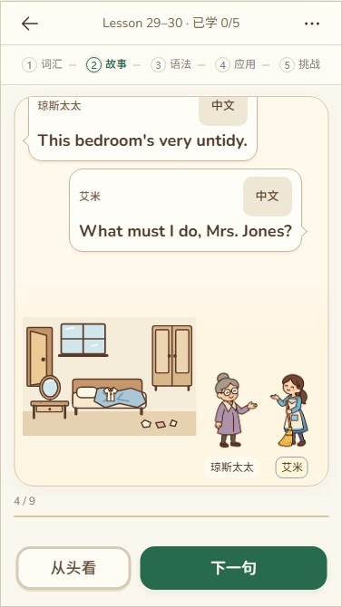
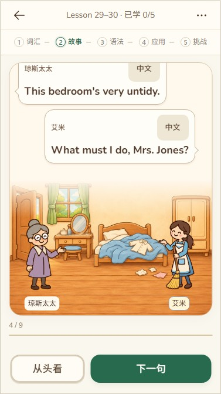
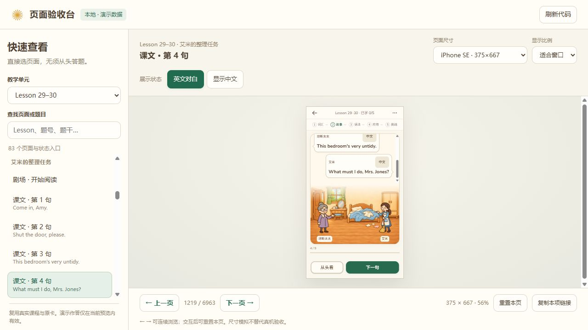

# Lesson 29–30 剧场回归 Lesson 1–2 的连续场景

2026-11-15 · codex/book-version · 本地修正。未提交、未推送、未发布。

## 实际问题与根因

用户指出整册扩展后的29–30没有遵循1–2的剧场。真实页面对照确认：视觉配置的背景为空，room-cast分成3∶2两列，左边缩略卧室示意图、右边并排小人物，形成大面积空白。此前几何检查验证了不越界、不遮姓名，但没有验证连续背景、人物尺寸和左右站位，因此通过不能代表该课构图符合样板。

## 修正

- 以1–2的实际剧场为基准：对白区透明，一张完整环境延伸到地面；琼斯太太与艾米站在左右前景，原人物、动作和对白顺序保留，姓名在脚下独立一行。
- 使用内置ImageGen生成[卧室背景](../../../assets/unit29-30/bedroom-world-v2.webp)，参照原纪念卡与认可环境，保留关着的窗、敞开的门、未整理的蓝色床铺、床上衣服、梳妆台灰尘、关闭的衣柜与地面纸屑。这里展示老师布置整理任务，不能把尚未执行的指令画成已经整理完。原示意图和原题素材仍保留。
- 提示框按新背景的位置重新校准，背景和提示层同为3∶2、同宽对齐，手机不再套旧缩略图的坐标。
- 修正旧样式覆盖人物宽度和网格对齐导致两人仍偏右的问题；不改任何作答或学习记录规则。

[完整提示词、原图路径、参考与SHA](room29-generations/bedroom-world-v2.json)。原稿保存在assets/learning-whole-book-v1/raw/bedroom-world-v2.png，仅作追溯；课程包使用采用的WebP。

## 回归与证据

新增room-story-continuity检查完整背景、房间宽度、人物可读尺寸和左右分布、透明对白、中文展开、下一句几何稳定及窗户提示，已接入影响检查。修改前在三档手机全部准确失败于“没有连续背景”；首次修改后继续抓出人物仍偏向右侧，修正旧选择器覆盖后通过。

- Chrome与WebKit共10项通过：1–2原样板及29–30全对白逐句推进（7＋9句，各三档手机）；29–30连续构图、展开中文和窗口提示（各三档手机）。
- 必测设备为iPhone SE 375×667、iPhone 14/15 Pro Max 430×932、iPhone 16 Pro Max 440×956，均为CSS px。320×568为独立压力场景，两引擎另2项通过，不冒称另一档iPhone SE。
- 实际账号单元回归1项通过：综合挑战20道原题、判分、只读回看、重新进入与原纪念卡。
- 内容／素材／影响规则56项首轮55通过，1项发现生成原稿被课程打包；原稿移入专用归档位置后，相关7项复验全部通过。72单元原教学定义和原纪念卡保护检查通过。
- 未运行全站CI；实体手机、微信／夸克、真实系统键盘和安全区本轮未实测。

初始失败、修正过程、最终浏览器和账号日志保存在output/room-story-*.log，对应截图与trace在output/room-story-continuity。

| 修改前：小示意图与挤在右侧的人物 | 修改后：完整场景与左右人物 |
| --- | --- |
|  |  |

[Pro Max 430](evidence/2026-11-15-room29/final-story-chrome-iphone-14-pro-max.jpg) · [Pro Max 440](evidence/2026-11-15-room29/final-story-chrome-iphone-16-pro-max.jpg)

[打开本地验收台：原反馈的第4句](http://127.0.0.1:4401/?unit=unit29-30&page=story-3&state=english&device=chrome-iphone-se&stars=1&preset=correct)

