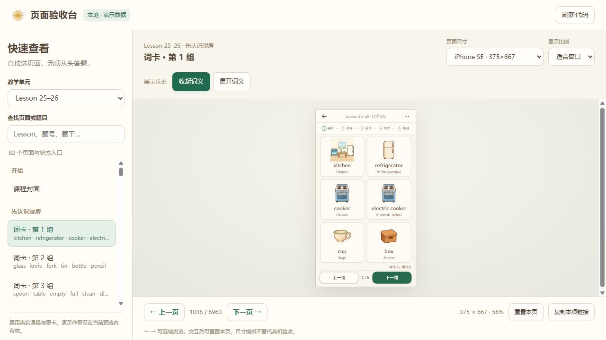

# Lesson 25–144整体视觉优化

2026-11-15 · codex/book-version · 本地开发及下列影响范围验收完成。未提交、推送或发布。

后续人工反馈发现29–30构图未对齐1–2，现已作[连续剧场专项修正](2026-11-15-lesson29-story-continuity.md)。以下保留整册首次验收范围；布局不越界不代表所有构图已获得用户认可。专项另增1张卧室背景。

随后已完成[全72单元剧场复查](2026-11-15-all-theatres-review.md)，新的剧场构图、姓名、道具和回归规则以该记录为准。本页保留前一阶段整体推广的实际范围。

## 范围与保留项

覆盖60个相邻课单元、1601个原词条、3741道原题。原课程内容、题目编号、答案、学习记录、授星规则、原纪念卡及日期不变。新呈现全部在独立映射和共享布局层实现，原卡仍按41:22等比展示。

## 连续词卡

插画／事实图先排，语境与文字卡顺接，每6张统一分页；不设分类入口，不为类型边界留空格，孤立卡片从左上排布。原词、音标、释义及例句保留，展开居中且操作栏不移动。

逐词来源由[分类登记](../word-cards/lesson25-144-classification.json)和[插画方案](../word-cards/lesson25-144-artwork-plan.json)记录。抽象表达优先使用本课原句或原搭配；保留原句中的过去式、复数等实际词形，不把它强改成词条原形。缺少合适原句时只显示原词和音标，不能捏造例句或用无关小人凑图。引用要移除练习编号、教师说明和截断称呼，但保留可追溯的原文片段。

同一个英文按本课词义审查：glasses区分眼镜和杯子，cold区分冷与感冒，left区分左边与leave过去式，pool不套用游泳池；难以从单张肉片区分的beef／lamb使用原句。序数不使用无日期的空日历冒充准确图示。

| Lesson | 插画／事实图 | 原句语境 | 原词文字卡 | 页数 | 原题数 |
| --- | ---: | ---: | ---: | ---: | ---: |
| 25–26 | 22 | 14 | 0 | 6 | 45 |
| 27–28 | 23 | 7 | 0 | 5 | 43 |
| 29–30 | 8 | 22 | 0 | 5 | 50 |
| 31–32 | 11 | 13 | 0 | 4 | 51 |
| 33–34 | 8 | 14 | 0 | 4 | 47 |
| 35–36 | 6 | 10 | 0 | 3 | 43 |
| 37–38 | 3 | 8 | 0 | 2 | 54 |
| 39–40 | 2 | 7 | 0 | 2 | 46 |
| 41–42 | 12 | 8 | 0 | 4 | 47 |
| 43–44 | 6 | 12 | 0 | 3 | 46 |
| 45–46 | 5 | 15 | 4 | 4 | 54 |
| 47–48 | 19 | 7 | 0 | 5 | 53 |
| 49–50 | 13 | 16 | 1 | 5 | 60 |
| 51–52 | 21 | 21 | 0 | 7 | 56 |
| 53–54 | 25 | 17 | 0 | 7 | 69 |
| 55–56 | 2 | 22 | 0 | 4 | 62 |
| 57–58 | 2 | 14 | 2 | 3 | 58 |
| 59–60 | 31 | 2 | 1 | 6 | 60 |
| 61–62 | 9 | 17 | 0 | 5 | 63 |
| 63–64 | 2 | 20 | 0 | 4 | 57 |
| 65–66 | 3 | 20 | 7 | 5 | 69 |
| 67–68 | 1 | 29 | 0 | 5 | 62 |
| 69–70 | 13 | 27 | 2 | 7 | 72 |
| 71–72 | 2 | 27 | 5 | 6 | 68 |
| 73–74 | 4 | 37 | 1 | 7 | 72 |
| 75–76 | 2 | 17 | 11 | 5 | 60 |
| 77–78 | 3 | 21 | 0 | 4 | 66 |
| 79–80 | 16 | 18 | 2 | 6 | 62 |
| 81–82 | 5 | 25 | 0 | 5 | 66 |
| 83–84 | 19 | 17 | 0 | 6 | 73 |
| 85–86 | 3 | 27 | 0 | 5 | 65 |
| 87–88 | 3 | 21 | 2 | 5 | 66 |
| 89–90 | 0 | 21 | 3 | 4 | 65 |
| 91–92 | 2 | 22 | 6 | 5 | 66 |
| 93–94 | 1 | 29 | 6 | 6 | 72 |
| 95–96 | 6 | 21 | 9 | 6 | 64 |
| 97–98 | 15 | 17 | 0 | 6 | 68 |
| 99–100 | 6 | 22 | 7 | 6 | 65 |
| 101–102 | 2 | 26 | 0 | 5 | 72 |
| 103–104 | 0 | 23 | 13 | 6 | 68 |
| 105–106 | 2 | 22 | 4 | 5 | 64 |
| 107–108 | 6 | 19 | 4 | 5 | 68 |
| 109–110 | 6 | 25 | 4 | 6 | 72 |
| 111–112 | 7 | 16 | 10 | 6 | 68 |
| 113–114 | 8 | 19 | 1 | 5 | 76 |
| 115–116 | 3 | 28 | 0 | 6 | 74 |
| 117–118 | 7 | 17 | 4 | 5 | 74 |
| 119–120 | 3 | 19 | 1 | 4 | 71 |
| 121–122 | 7 | 15 | 1 | 4 | 70 |
| 123–124 | 7 | 14 | 3 | 4 | 73 |
| 125–126 | 7 | 17 | 0 | 4 | 73 |
| 127–128 | 4 | 14 | 0 | 3 | 65 |
| 129–130 | 2 | 14 | 2 | 3 | 66 |
| 131–132 | 2 | 14 | 2 | 3 | 65 |
| 133–134 | 5 | 7 | 0 | 2 | 57 |
| 135–136 | 1 | 11 | 0 | 2 | 60 |
| 137–138 | 1 | 10 | 1 | 2 | 54 |
| 139–140 | 2 | 10 | 0 | 2 | 60 |
| 141–142 | 3 | 15 | 0 | 3 | 61 |
| 143–144 | 13 | 6 | 5 | 4 | 65 |
| 合计 | 432 | 1045 | 124 | 276 | 3741 |

## 剧场、答题与结算

采用暖纸、暖棕描边、柔和色彩和轻纹理。16张新环境图与原有认可环境复用，人物保留原身份、原姿态与交接动作。普通场景统一连续背景；承担准确位置／数量事实的完整图片保持原图、比例及热点同画板，不用通用环境覆盖教学线索。日夜、房间与室外切换在每课视觉配置中明确登记。

剧场分为完整事实画面、事实画面加人物、同比例动态画板、独立人物、合成人物及树林讲述场景。姓名在图片之外预留独立行及间隔，先测姓名高度再适配人物，不借某张图的透明脚边放字。纯装饰地点牌不显示；影响故事理解的时间／地点提示移到正常排版中，不能悬浮盖住人物。

题目复用相同物品插画时按明确资源路径映射，不改原题稿。涉及颜色、数量、位置、时钟、金额和带识别文字的事实图保持原来源。答题和结算继续使用持续纸面、固定反馈与操作栏，绿色对号只代表相应环节已获星。挑战结算先查看纪念卡，首页／下一课只出现在原卡页。

## 素材审查与技术边界

生成提示词、原参考和生成回执保存在whole-book-image-jobs.json、whole-book-world-jobs.json和whole-book-generations目录。原稿单独留存，发布只引用采用的WebP。胡须首版出现白雾边缘，被排除；修订版保留真实透明背景，并在正常缩放导入时增加透明安全边距。

课程图片仍先准备并解码再展示，不因新节点的第一次测量重复启动整页加载保护。阅读位置按原词锚点续接，新旧分页可迁移；位置元数据不能制造答案、完成状态或星星。

## 手机排版与验收台补充

语境按本课原文选取可独立理解的短句或搭配。卡片网格必须检查实际句子、词名、音标的文字边界；只检查卡片外框会漏掉内部交叠。小屏按可用行高适配语境字号，下限16px；仍然过长时缩短为原文中真实存在的片段，必要时改为原词正面。原题文与原例句保持，不靠缩小到不可读字号解决。

普通短题保留一屏操作。较大的原材料进入“查看题目材料”，弹层保留原图比例、原情境及原反馈，关闭后题目、作答与布局不变。31道材料题的“展开材料”状态接入验收台；15个易溢出的短题有独立回归。材料的隐藏副本不能再次参与场景和文字适配，否则会生成重复内容。

验收台词卡页和展示状态切换复用已加载课程；实际检查同一内嵌页面、图片准备状态和分页位置，不把反复重载课程产生的延迟当作必要加载。

## 验收状态

本轮为相关学习界面的分批检查及修复后定向复验，不是全站CI。结果记录保留首轮失败与后续复验；新增共享词卡排版同时覆盖前12个单元。未运行完整提交检查或官网发布验收。

| 检查 | 实际执行与结果 |
| --- | --- |
| 原内容与采用协议 | 最终34项通过，检查工作流另38项通过；核对72单元原教学定义、原卡、词义来源、读取位置和采用素材。 |
| 全部原题／各类页面 | 60单元、3741题在三档手机检查，共11223个题目布局；1125个页面入口共3375个布局。180项通过，后续修改另作定向复验。 |
| 剧场 | 60单元763句，三档手机2289个姿态；复核人物、姓名、地点提示及昼夜背景，修复后对应场景另验。 |
| 词卡 | 新60单元276页；因共享文字适配，最终扩展到72单元1909词、331页，三档手机检查真实文字边界及翻卡。长句交叠修复后复验通过。 |
| 切换闪烁 | 60单元真实词卡按钮、180份逐帧记录、16860个采样帧，未发现缺图／未解码图或重复整页加载层；此结论限于已采样路径。 |
| 真实账号 | 全60单元综合挑战1367道原题，经实际答题检查判分、只读回看、刷新及原卡；全60单元词卡旧位置迁移与新会话续学。首轮8项测试辅助问题修正后定向复验通过。 |
| 短题与材料弹层 | 15个短题，三档手机验证主操作、反馈稳定、材料原比例、关闭后题文与记录不变；43–46场景共享背景另验。 |
| WebKit | 72单元词卡文字、6个重点剧场、15个短题和2个场景主题；95项中首轮94通过，剩余139–140长句修复后通过。最终69–70、139–140词卡及119–120夜景在两引擎共6项复验通过。验收台快切另4项通过。 |
| 额外尺寸 | 25、29、43、59、95、121、125、143起始的8个单元，在320×568、768×1024、1366×768执行各类页面检查，8项通过。 |

三档必测尺寸为Chrome设备清单的iPhone SE 375×667、iPhone 14/15 Pro Max 430×932、iPhone 16 Pro Max 440×956，单位CSS px。自动模拟不等于实体手机、微信／夸克、真实键盘或安全区验收；这些项目本轮未做。WebKit早期并行启动／加载失败保留日志，未计为通过；随后使用串行检查，修复验收台重载和隐藏材料被重复加工的问题。

可追溯材料：

- [汇总计数及设备清单](evidence/2026-11-15-whole-book/verification-counts.json)、[逐词手机截图索引](evidence/2026-11-15-whole-book/word-pages.json)。
- [验收执行摘要](evidence/2026-11-15-whole-book/verification-runs.json)记录首轮结果和对应补测；完整日志、trace及失败截图留在本地output/whole-book-design。
- [逐课场景配置](lesson25-144-scenes.json)、[词卡生成任务](whole-book-image-jobs.json)、[环境生成任务](whole-book-world-jobs.json)。sources目录是原素材／候选审查资料，包含未采用版本，不是最终效果集。

交付预览：[本地验收台 Lesson 25–26](http://127.0.0.1:4401/?unit=unit25-26&page=words-0&state=collapsed&device=chrome-iphone-se)。可按单元、页面、展示状态和设备继续检查。开发在codex/book-version；未提交、未推送、未发布。

