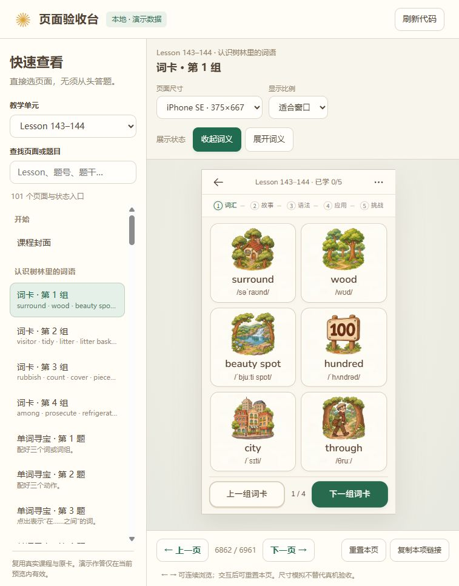

# 词卡插画风格复核与首组修正

2026-11-09，用户指出“仍有很多词卡没有和剧场、纪念卡保持一致”。复核确认问题存在。**上一轮完成的是全书共用界面推广；全书词卡美术统一没有完成。** 原功能／布局报告不能充当插画风格验收。

## 实际发现

1. 当前Lesson143–144首组仍是简化的树、三角山和楼房图标，与原纪念卡的树冠、木纹、环境细节明显不同。见[本次修正前截图](../learning-flow/evidence/2026-11-09-word-art-review/01-unit143-words-before.jpg)。
2. 旧派生记录共1,765条，其中1,755条是`native-vector-lighting`，仅把原SVG填色替换成渐变。原轮廓和人物比例保留，因此无法解决用户指出的插画差距。其余10条复用记录也不能靠文件名自动判为合格：`cast-robert-v1.webp`实际包含两人，用作“I”有指代问题，已撤回该映射，恢复原单人指自身图，且不把此回退算作画风通过。
3. 词卡原本按56px小图标安排插图面积，直接放入细致插画会损失辨识度。现在仅对已采用插画启用更大的等比区域；较高手机使用可用高度分配三行，英文、音标和翻组保持完整。

## 本次实际采用范围

只采用Lesson143–144首组以下六张；采用源、SHA、词义检查与真实页面证据写入[采用清单](../../../assets/word-art-v2/adoptions.json)。**这不是全72课词卡美术验收完成。** [逐词台账](coverage.json)的其余1,903项标记为本轮未审核；其中可能包含之前已经合格的素材、可复用素材和应保真的事实图，并不表示必须把它们全部重新生成。

| 词条 | 实际插画与词义核对 | 采用文件 |
| --- | --- | --- |
| surround | 树木在房屋前后左右，形成可辨认的环绕 | [插画](../../../assets/word-art-v2/surround-v1.webp) |
| wood | 真实树林场景，未画成木材 | [插画](../../../assets/word-art-v2/wood-v1.webp) |
| beauty spot | 有湖泊、瀑布和植被的风景点 | [插画](../../../assets/word-art-v2/beauty-spot-v1.webp) |
| hundred | 木质教学牌只显示准确的100 | [插画](../../../assets/word-art-v2/hundred-v1.webp) |
| city | 多栋多层建筑组成城市街区 | [插画](../../../assets/word-art-v2/city-v1.webp) |
| through | 保持原叙述者衣着身份，沿路径穿过两树之间 | [插画](../../../assets/word-art-v2/through-v1.webp) |

使用内置ImageGen逐张生成，直接附本课原纪念卡作为参考，未使用CLI/API备用方式。完整实际提示词、原生成路径和原稿位置见[生成记录](generation-receipt.json)。原稿保存在`assets/word-art-v2/raw/`，网页使用512px透明WebP；只做等比缩放和格式压缩，未用滤镜或代码重画图片。原纪念卡、题库、词义、音标、例句、答案、学习记录与奖励定义保持。

## 修正后的验收规则

- 批量渐变脚本已改为采用清单编译器。默认只采用明确通过的条目；`--preview`用于生成后、页面核对前的本地预览，不计为验收通过。
- `native-vector-lighting`不能登记为画风通过。必须记录真实参考、词义核对、原图审查及页面证据，采用图SHA改变后须重新检查。
- SVG、PNG或WebP本身不决定是否合格。国旗、数字及必要语法图解先保真；人物、物品和环境插画按真实造型、比例、线条、材质、光照和构图比较。
- 不凭素材文件名推断人物数量、身份或含义。复用必须查看实际内容；双人合图不能当作单人指代图。
- 全书剩余美术工作保持未完成状态，按人物／职业、物品、动作／场景逐项复用或重绘。没有实际看过原图与页面的词卡不得批量写“通过”。

## 实际检查

Chrome预设iPhone SE375×667、14/15 Pro Max430×932、16 Pro Max440×956：六卡布局、真实插画加载、无卡内滚动条、每张展开后的原英文／音标／释义、分页不跳动，以及Lesson7–8的“I”映射，3项浏览器测试通过。9项Node检查通过，包含审批规则、采用图哈希与证据存在、透明通道、正式资源包包含新图且排除生成原稿、72课原教学数据及原卡基线。

WebKit首轮与独立复查均在`browserContext.newPage`阶段退出，尚未打开课程，本次不记为通过，也不把它称作课程页面失败；日志保存在`output/word-art-v2-final-phones/`及`word-art-v2-webkit-recheck/`。实体微信／夸克未测，未运行无关全量CI。

本次实际对照步骤：

1. 旧词卡：造型不符，未通过美术检查。
2. 原纪念卡与剧场：作为角色、环境和材质参考，原素材保持。
3. 新六词卡：逐张检查词义与风格，再检查三个必测手机尺寸；本次采用范围仅这六张。

[Pro Max430](../learning-flow/evidence/2026-11-09-word-art-review/05-words-430-final.jpg) · [Pro Max440](../learning-flow/evidence/2026-11-09-word-art-review/06-words-440-final.jpg) · [原纪念卡](../learning-flow/evidence/2026-11-09-word-art-review/02-unit143-original-card.jpg) · [原剧场](../learning-flow/evidence/2026-11-09-word-art-review/08-original-theatre-reference.jpg)

未提交、未推送、未发布；本地验收台定位到Lesson143–144词卡首组。
